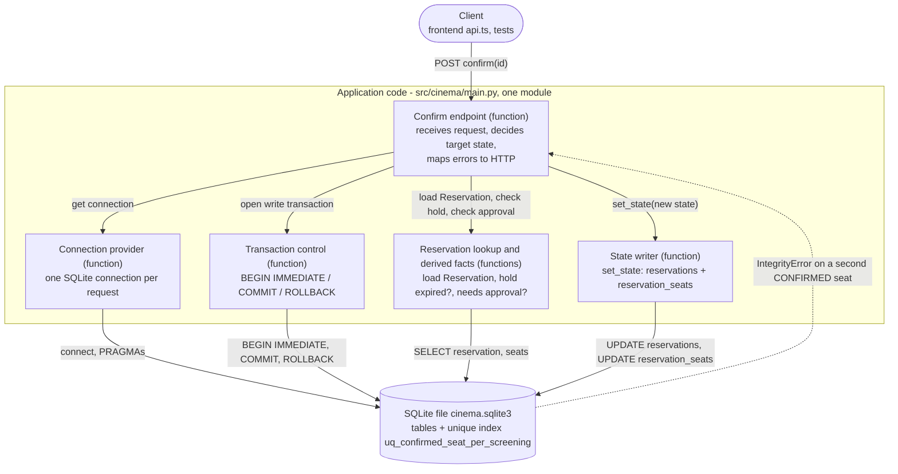
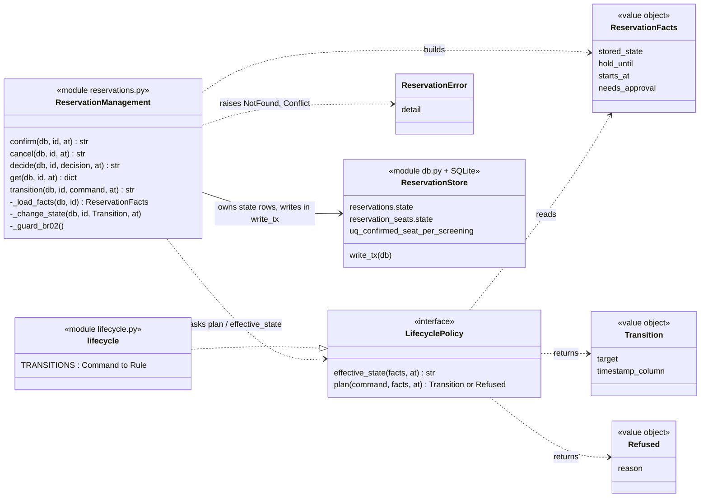
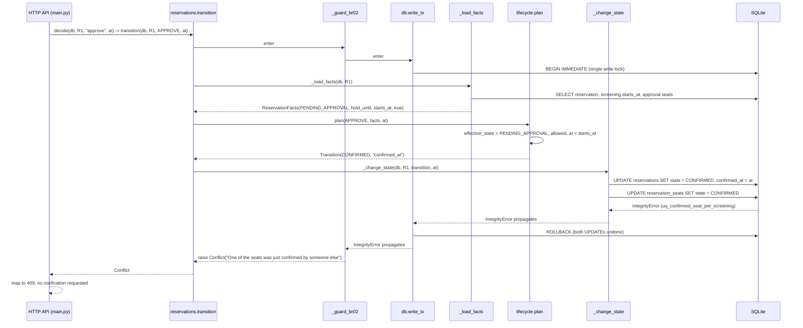

# Architecture and Decisions

Short architecture notes plus the decision records for everything that was a real choice.
Each ADR says what we picked, what it costs, and what would make us change our mind.

## Architecture at a glance

> **This is the C01 target sketch, not what the code is today.** The architecture the code follows since C03 (ADR-008) is G2 in [`c03-architecture.md`](c03-architecture.md#g2-to-be-static-architecture); the AS-IS structure of the Confirm scenario before that refactor is in "C03 - Part A" at the end of this file.

```
          HTTP
   Viewer ────► API layer (FastAPI)
                   │   request/response models, HTTP status mapping
                   ▼
                Domain layer
                   │   Reservation lifecycle, overlap rule, no-orphan rule
                   ▼
                Persistence layer        ──────►  SQLite
                   │   repositories, transactions      ▲
                   │                                   │
                   │                          uq_confirmed_seat_per_screening
                   │                          = the no-double-booking invariant
                   ▼
              NotificationService (boundary, stubbed)
```

Three layers, one outbound boundary. The rule that must never break is enforced at the
bottom, in the database, for the reason recorded in ADR-004.

---

## ADR-001 — The reserved resource is a Seat

**Status:** accepted

**Context.** "Cinema reservation" can be modelled with at least three different resources,
and the choice decides whether the assignment's mandatory rule ("two confirmed reservations
for the same resource must not overlap in time") even applies.

**Decision.** `Resource = Seat` — a physical seat in a hall, occupied for the duration of
the screening it was booked for.

**Alternatives rejected.**

| Alternative | Why not |
|---|---|
| `Resource = Hall`, reservation = a scheduled screening | Makes the user a cinema programmer, not a moviegoer. The interesting domain (seat choice) disappears. |
| `Resource = Screening with capacity`, reservation = N seats | The mandatory rule stops being about time overlap and becomes a capacity rule. Different rule than the one we were asked to model. |

**Consequences.** The overlap rule applies literally and needs no reinterpretation. The
cost is that occupancy must always be *derived* from reservations rather than stored on
the seat, otherwise two sources of truth would drift.

---

## ADR-002 — Python 3.11 + FastAPI + SQLite

**Status:** accepted

**Context.** The brief names Java 21 + Spring Boot + Maven + PostgreSQL as the supported
stack and allows any other stack provided the team supports it themselves and justifies
the choice. This ADR is that justification.

**Decision.** Python + FastAPI + SQLite (via the standard-library `sqlite3` module),
tested with pytest.

**Why.** The team is faster in Python than in Java, and in a course where the deliverable
is a *design* under a *time budget*, framework familiarity converts directly into domain
work. FastAPI gives request validation and an OpenAPI description without extra
machinery. We deviate from the recommended PostgreSQL as well: SQLite is a single file
with no server to install, configure, or containerise, which matters for a team of
students who need to be productive from commit one. It still gives us the one guarantee
ADR-004 depends on — a partial unique index — so nothing about the invariant we care about
is lost by leaving PostgreSQL behind.

**Costs we accept.**

- No compile-time type checking. Mitigation: type hints plus tests around the domain rules.
- We support the stack ourselves; nothing about it is pre-blessed by the course.
- SQLite allows only one writer at a time for the whole database file. Concurrent readers
  are fine, but concurrent confirms serialise on a lock instead of interleaving the way
  they would under PostgreSQL's MVCC. ADR-004's spike measures what this means in practice
  for the no-double-booking invariant.
- SQLite has no native `ENUM` or timezone-aware timestamp type; `schema.sql` uses `TEXT`
  with `CHECK` constraints and ISO-8601 strings instead.

**What would change our mind.** If the selected future pressure (a premiere on-sale burst,
several hundred concurrent confirms) turns out to need real concurrent writers rather than
serialised ones — something the spike in ADR-004 does not test at that scale — moving to
PostgreSQL is still cheap this early: the domain model and all three documents are
stack-independent.

---

## ADR-003 — Hold expiry is evaluated lazily, with no background job

**Status:** accepted

**Context.** A `DRAFT` reservation holds its seats for 15 minutes. Something has to make
the hold stop mattering once it passes.

**Decision.** No scheduler. `hold_until` is compared to the current time whenever a
reservation is read or confirmed. A `DRAFT` row whose hold has passed is treated as
`EXPIRED` and stops occupying its seats.

**Alternative rejected.** A periodic job flipping stale `DRAFT` rows to `EXPIRED`. It buys
no behavioural difference — a hold that nobody observes has no effect either way — and it
adds a scheduler, a failure mode, and an operational thing to monitor.

**Consequences.** The `EXPIRED` state may be *implicit* in the table for a while: a row can
read `DRAFT` while behaving as expired. Every availability query must therefore include the
`hold_until > now()` predicate, and forgetting it in one query is a plausible bug. We accept
that and keep the predicate in a single shared query helper rather than repeating it.
Since PR #11 nothing writes `EXPIRED` at all: Confirm used to store it when it refused an expired
hold, now the row keeps `DRAFT` (or `PENDING_APPROVAL`) and only reads as `EXPIRED`.

**What would change our mind.** A reporting or analytics need for accurate `EXPIRED`
timestamps, which lazy evaluation cannot provide.

---

## ADR-004 — Double-booking is prevented by a database constraint, not application code

**Status:** accepted — **backed by the C01 engineering spike**

**Context.** Two viewers may confirm the same seat at the same instant. We did not know
whether a `SELECT`-then-write availability check in the application survives that.

**Decision.** The invariant lives in SQLite:

```sql
CREATE UNIQUE INDEX uq_confirmed_seat_per_screening
    ON reservation_seats (screening_id, seat_id)
    WHERE state = 'CONFIRMED';
```

The application's availability `SELECT` is kept for user experience only and is explicitly
**not** a correctness guarantee. `IntegrityError` (`UNIQUE constraint failed`) on confirm
is mapped to **HTTP 409**.

**Evidence.** Measured, not assumed. With the index dropped, two concurrent confirms both
succeeded and the seat was sold twice; with it in place, exactly one succeeded. The
application-level check returned its "seat taken" outcome zero times in either run. Full
transcript and method in [`evidence-and-evolution.md`](evidence-and-evolution.md).

**A wrinkle specific to SQLite.** Unlike PostgreSQL, SQLite only ever lets one connection
hold the write lock, so the two confirms cannot truly interleave — the second writer blocks
until the first commits. The spike shows that this does **not** make the application-level
`SELECT` safe: both threads still read "free" before either one writes, so the outcome the
invariant has to prevent is the same, just reached by a different path (a blocked writer
that then fails the uniqueness check, instead of two writers whose commits race). See
`evidence-and-evolution.md` for what this means for ADR-002's stated cost.

**Alternative rejected.** Pessimistic locking with `SELECT ... FOR UPDATE`-style locking
reads. The spike shows the index alone is sufficient, and SQLite's single-writer model
already serialises writes for us, so explicit locking would only add complexity for no
extra correctness during precisely the premiere burst of our selected future pressure.

**The assumption this rests on.** The index is keyed on `screening_id`, not on a time range.
It is equivalent to the time-based rule in the Project Frame **only while two screenings in
one hall never overlap**. That assumption is recorded in
[`intent-and-change.md`](intent-and-change.md). If overlapping screenings ever become
possible, this index silently stops enforcing the stated rule. SQLite has no exclusion
constraint (PostgreSQL's `EXCLUDE USING gist` is not available here), so the fix would have
to be an application-level check over stored time ranges, done inside the same transaction
as the confirm and re-verified by re-reading under the write lock — a real loss of the
database-level guarantee this ADR currently relies on.

We did not build that now because the situation cannot currently arise, and because it
would reintroduce exactly the "does the check survive concurrency" question this spike was
run to answer.

---

## ADR-005 — `reservation_seats` denormalises `screening_id` and `state`

**Status:** accepted

**Context.** ADR-004 puts the invariant in a unique index. SQLite (like PostgreSQL) cannot
index across two tables, and both columns the index needs live on the parent `reservations`
row.

**Decision.** Copy `screening_id` and `state` onto each `reservation_seats` row.

**Consequences.** This is a genuine denormalisation and we are not pretending otherwise:
every state transition must now write *both* tables, and if one write is forgotten the index
protects the wrong thing. We accept it because the alternative is losing the database-level
guarantee that ADR-004 is built on, and a missed update is a far more visible bug than a
silent double-booking. The transition is confined to a single repository method so there is
exactly one place to get it right — and a database trigger keeping the two in sync is the
obvious hardening if that discipline ever slips.

---

## ADR-006 — The no-orphan rule is evaluated at create, and row ends count as occupied

**Status:** accepted, with a known open question

**Context.** "A reservation must not leave exactly one free seat isolated between occupied
seats in the same row" leaves two things undefined: *when* it is checked, and whether the
end of a row behaves like an occupied neighbour.

**Decision.**

1. Evaluated at **create**, against the Project Frame's definition of *occupied* — so live
   `DRAFT` holds count.
2. **The ends of a row count as occupied.** A single free seat next to the aisle is an
   orphan too.

**Why.** Checking at create tells the viewer the truth at the moment they choose, instead of
accepting their choice and rejecting it at payment time. Counting row ends matches the
commercial reason for the rule — a lone seat at the edge is just as unsellable as a lone
seat in the middle.

**Consequences.** Point 2 has a consequence worth stating plainly: **seat 2 of an
otherwise empty row can never be reserved**, because it strands seat 1. This is intended,
but it is the kind of thing that looks like a bug to someone who has not read this ADR.

Point 1 carries the risk recorded as the Project Frame's *Unknown*: a reservation can be
rejected because of a hold that expires seconds later. We have no data to choose better,
so we picked the option that never shows a viewer a seat map they cannot act on.

**What would change our mind.** Observed false rejections in real use, or a cinema operator
telling us aisle-adjacent singles do sell.

---

## ADR-007 — No frontend in CP1

**Status:** accepted for the CP1 path, overtaken in practice — a React frontend (`src/frontend/`)
was built anyway (started 2026-09-15, connected to the API 2026-09-28; recorded as a mismatch in
C03 Part A, A3). The CP1 walking skeleton and its automated check (README) are still API-only and
do not need the frontend.

**Context.** A seat map is the obvious UI for this domain and is tempting to start early.

**Decision.** CP1 delivers the HTTP API and its automated check only. No frontend.

**Why.** The CP1 walking skeleton is defined as `POST /reservations → validate → persist →
return reservation ID → automated check`. A frontend adds a second stack and a second CI
path without advancing any part of that path. It is planned for after the skeleton actually
runs.

**Consequences.** Until then the seat map exists only as the `check availability` response,
and the domain rules are demonstrated by tests rather than by a picture.


---

## ADR-008 — Reservation Management owns every change of Reservation state

**Status:** accepted (C03). Details and views: [`c03-architecture.md`](c03-architecture.md).

**Rozhodovací otázka.** Kdo smí měnit stav rezervace (`reservations.state` a jeho kopii v
`reservation_seats`) a kde se dělá autoritativní rozhodnutí o potvrzení, aby při souběhu platilo BR-02
a obě tabulky se nikdy nerozešly?

**Context.** Before C03 the code was one module. Four endpoints called `set_state` after their own
copy of the guards, and two of them caught `sqlite3.IntegrityError` themselves. Part A showed that a
failed `UPDATE reservation_seats` does not abort the transaction, so only the explicit `ROLLBACK`
keeps the tables consistent (A3, A8).

**Drivers.** D1 concurrency/BR-02; D2 one owner of state and its sync; D3 pending approval outlives
the request; D4 a failing notification must not change the outcome.

**Alternative A.** A module *Reservation Management* in the same process performs every transition
(create, confirm, cancel, approve/reject, derived expiry) through one `change_state`, owns the
transaction and turns the index violation into a conflict. The HTTP API only requests.

**Alternative B.** Keep the handlers as they are and let the database keep the two tables in sync
(composite FK `(reservation_id, state)` with `ON UPDATE CASCADE`). Checked in a spike: the cascaded
`UPDATE` is atomic, a conflict leaves both tables unchanged, even if `COMMIT` still runs.

**Decision.** **A.** The unique index `uq_confirmed_seat_per_screening` stays as the last line of
defence (ADR-004). Notifications are requested by the HTTP API after the command returned, not from
inside Reservation Management (D4).

**Why.** B protects against a careless writer but does not say *whether* a transition is allowed:
the guards (`DRAFT` only, hold alive, `PENDING_APPROVAL` before `starts_at`) stay copied in handlers,
and every handler still maps the index violation itself. A puts the guards, the BR-02 decision and
the sync in one place, so the next transition (the next change card) is one function. A also needs no
schema migration of existing databases.

**Accepted negative consequences.**
- Nothing in the database stops someone from writing `UPDATE reservations SET state` outside the
  module; protection is a convention checked by `tests/test_architecture.py`, not a constraint.
- A notification is requested after the commit and in its own transaction. A crash between the two
  loses it; there is no automatic retry (undelivered outbox rows are retried only in the sense that the
  browser fetches them again).
- Authorisation of `decide` is still missing; the owner of the transition is clear, who may *ask* for
  it is not enforced.

**We reopen this decision when.** A second writer of Reservation state appears (a worker, another
service) or the database changes (then B's constraint, or a transactional outbox, becomes necessary);
the notification becomes a real external provider that needs retry; or roles are added and the
authorisation belongs next to the transition.

---

# C03 — Part A: AS-IS trace of Confirm Reservation

Everything below was checked against the code, a test, or a runtime run. Line numbers refer to
commit `a3e7a8e` (`main`); they will drift when `main.py` changes, the function names will not.
**Update for C03 (commit `fed5106`, the notification feature):** the notification rows in A2, A3, A6 and A7 were
corrected; the other items were checked against the code and remain true. Line numbers below are from
`a3e7a8e` and have drifted. "Runtime trace" means the output of [`docs/trace_confirm.py`](trace_confirm.py) (run `python -X utf8 docs/trace_confirm.py` from the repository root; reservation ids differ between runs because the demo data is random).

## A1. Scenario

| Item | Value |
|---|---|
| Scenario / operation | **OP-03 Confirm Reservation**, including the v0.2 variant "a seat requires approval" |
| Requirements | OP-03 observable requirement(s) in [`operations-specification.md`](operations-specification.md) (that spec numbers operations, not `REQ-xx`) |
| Rules / invariants | **BR-02** exclusive resource (`uq_confirmed_seat_per_screening`, ADR-004); ADR-005 (reservation and seat rows change together); ADR-003 (lazy expiry) |
| Baseline | v0.2 |

## A2. Main success path → code

Files: `src/cinema/main.py` (**M**), `src/cinema/schema.sql` (**S**).

| Step of OP-03 (v0.2) | Realised by | Evidence |
|---|---|---|
| receive the confirm request | route `POST /reservations/{id}/confirm`, function `confirm_reservation`; one SQLite connection per request from `get_db` | M:338-339, M:90-95; caller is `api.confirmReservation` in `src/frontend/src/lib/api.ts:80` |
| begin a transaction that excludes other writers | `write_tx` → `BEGIN IMMEDIATE` | M:42-52, used at M:343 |
| load the Reservation (404 if unknown) | `get_reservation_or_404` → `SELECT * FROM reservations` | M:157-161, called at M:344 |
| check the transition is allowed: still `DRAFT` and hold not passed | `is_expired` (compares `hold_until` with `now()`); `state != "DRAFT"` → 409 | M:164-165, M:345, M:348-349 |
| decide the target state (v0.2) | `needs_approval` (any seat with `requires_approval = 1`) → `PENDING_APPROVAL`, otherwise `CONFIRMED` | M:181-186, M:350-354 |
| change state of the reservation **and** its seats | `set_state` (two `UPDATE`s, sets `confirmed_at` only for `CONFIRMED`) | M:122-127, called at M:352 / M:354 |
| evaluate the seat conflict (BR-02) | **not in application code** — raised by the unique index while the `UPDATE reservation_seats` runs | S:94-96, M:127; see A3 |
| persist | `COMMIT` when the `with write_tx` block ends without an exception | M:52 |
| answer the caller | `{"reservation_id", "state"}` with HTTP 200 | M:359 |
| notify (`NotificationService.reservation_confirmed`) | *(updated after `fed5106`)* `notify("reservation_confirmed" or "reservation_pending_approval", id)` is called after the `with write_tx` block; `BrowserNotifications` writes a row to `notifications`; any error is logged and swallowed | `main.py` `notify`, `src/cinema/notifications.py`, `tests/test_notifications.py` |

Tests that exercise this path: `TestConfirm::test_draft_becomes_confirmed_together_with_its_seats`
(tests/test_c02_operations.py:245), `TestConfirmNeedingApproval::test_confirm_on_a_vip_seat_waits_for_a_decision`
(:380).

## A3. Alternative branch: seat conflict → confirmation rejected

| What v0.2 says | Where the condition is detected | Where the outcome is decided | What the caller gets |
|---|---|---|---|
| OP-03: if a seat of this reservation is already `CONFIRMED` for the screening, the write fails, nothing of this reservation becomes `CONFIRMED`, answer `409` | Inside SQLite: the partial unique index `uq_confirmed_seat_per_screening` (S:94-96) rejects `UPDATE reservation_seats SET state='CONFIRMED'` (M:127). There is **no** conflict query in `confirm_reservation` (M:344-354) | The `IntegrityError` leaves the `with write_tx` block → `ROLLBACK` (M:49-51) → caught in `confirm_reservation` (M:355-356) and turned into `HTTPException(409)` | `409 {"detail": "One of the seats was just confirmed by someone else"}`; the loser stays `DRAFT` with `DRAFT` seats |

Runtime trace (two `DRAFT` reservations on the same two seats, confirmed one after the other):

```
first  confirm -> 200 {'reservation_id': 621, 'state': 'CONFIRMED'}
second confirm -> 409 {'detail': 'One of the seats was just confirmed by someone else'}
stored first  : ('CONFIRMED', ['CONFIRMED', 'CONFIRMED'])
stored second : ('DRAFT', ['DRAFT', 'DRAFT'])

replaying set_state() by hand for the loser, statement by statement:
UPDATE reservations       : ok (no error)
UPDATE reservation_seats  : raised IntegrityError - UNIQUE constraint failed: reservation_seats.screening_id, reservation_seats.seat_id
COMMIT                    : reached
```

The last two lines matter: SQLite raises **at the statement**, and a failed statement does **not**
abort the transaction — `COMMIT` still succeeds and would persist the first `UPDATE`
(reservation `CONFIRMED`, seats `DRAFT`). Only the explicit `ROLLBACK` in `write_tx` (M:49-51)
keeps the two tables consistent. Also covered by
`TestConfirm::test_multi_seat_conflict_leaves_no_seat_confirmed` (:283) and
`test_two_simultaneous_confirms_on_one_seat_give_exactly_one_200` (:293).

### Differences between v0.2 and the implementation

| Specification | Implementation | Evidence |
|---|---|---|
| OP-03 step 4: the unique index "is checked at commit" | Checked when the `UPDATE reservation_seats` statement executes; `COMMIT` is not where it fails | runtime trace above; matches C01 evidence item 4 ("fails … before it can commit") |
| OP-03 step 5: after commit, `NotificationService.reservation_confirmed` is called | *(was absent at `a3e7a8e`; implemented in `fed5106`)* the call exists, in its own transaction, errors swallowed. The `PENDING_APPROVAL` variant also notifies, which v0.2 left unspecified *(spec since updated: OP-03 Variant step 5)* | `confirm_reservation` in `main.py`; `test_failed_notification_never_fails_the_reservation` |
| *(C01 sketch, not v0.2)* "Architecture at a glance" above shows an API layer, a domain layer, a persistence layer and a stubbed `NotificationService` | One module. HTTP handling, business rules and SQL sit in the same functions (`confirm_reservation` receives, decides and maps the error) | M:1 ("deliberately one module, plain SQL, no ORM"), M:338-359 |
| *(C01, not v0.2)* ADR-007 "No frontend in CP1" | A React frontend exists and calls this endpoint | `src/frontend/src/lib/api.ts:80` |

## A4. Parts of the implementation that realise the scenario

The application is one module, so the blocks are logical groups of functions, not classes.

| Part (type) | Contains | Role in this scenario | Evidence |
|---|---|---|---|
| **Confirm endpoint** (function) | `confirm_reservation` | receives the request, **decides** the target state, maps failures to HTTP — all in one function | M:338-359 |
| **Transaction control** (function) | `write_tx` | `BEGIN IMMEDIATE` / `COMMIT` / `ROLLBACK`; the single-writer guarantee and the rollback of partial writes | M:42-52 |
| **Reservation lookup & derived facts** (functions) | `get_reservation_or_404`, `is_expired`, `needs_approval`, `now` | load the aggregate, decide "hold still alive" and "needs approval" | M:157-161, M:164-165, M:181-186, M:98-99 |
| **State writer** (function) | `set_state` | writes the new state to `reservations` **and** `reservation_seats` (ADR-005) | M:122-127 |
| **Connection provider** (function) | `get_db`, `connect` | opens the SQLite connection per request, sets `foreign_keys`, WAL, `busy_timeout` | M:90-95, M:32-39 |

Outside the application code: the SQLite file with its schema and the unique index (S:57-96).

## A5. State, state change, and one rule

**State**

| Question | Answer | Evidence |
|---|---|---|
| Where is a Reservation's state stored permanently? | In the SQLite file `cinema.sqlite3` (`DB_PATH`), **twice**: `reservations.state` and a denormalised copy `reservation_seats.state` per seat | M:25; S:61-62, S:80-81; ADR-005 |
| Which code decides and performs the transition used here? | **Decides:** the `if/elif` chain in `confirm_reservation` (expired → `EXPIRED`; not `DRAFT` → 409; needs approval → `PENDING_APPROVAL`; else `CONFIRMED`). **Performs:** `set_state`. The same pair is used by cancel (M:371) and decision (M:388, M:390). | M:345-354, M:122-127 |

**Rule: BR-02 (no two `CONFIRMED` reservations for one seat and screening)**

| Question | Answer | Evidence |
|---|---|---|
| Where is the condition determined? | In the database, by the partial unique index, when a seat row is written as `CONFIRMED` | S:94-96 |
| Where is the outcome decided? | The transaction: any `IntegrityError` → `ROLLBACK` in `write_tx`; the HTTP mapping to 409 in the endpoint | M:49-51, M:355-356 |
| Where is the resulting state change performed? | Nowhere on conflict: the rollback discards both `UPDATE`s. On success `set_state` performs it | runtime trace; M:122-127 |

Several places make this decision: `confirm_reservation` (M:355) and `decide_reservation`
(approve, M:391) each catch `sqlite3.IntegrityError` and map it to 409. Create and cancel do
not rely on the index; create checks "occupied" itself (`OCCUPIED_SEATS_SQL`, M:105-119) inside the
same write lock.

## A6. Dependencies used by this scenario

| Dependency | Where it attaches | Which part knows its technical API | Evidence |
|---|---|---|---|
| SQLite (file database) | `connect()` opens `sqlite3.connect(DB_PATH)`; every SQL statement of the scenario | **All** parts: connection provider, transaction control, lookup functions, state writer, and the endpoint itself (it catches `sqlite3.IntegrityError`) | M:32-39, M:355 |
| System clock | `now()` = `datetime.now(UTC)`, ISO-8601 strings compared as text | lookup functions (`is_expired`), `seed.iso` for the format | M:98-99, M:164-165; `src/cinema/seed.py` (`iso`) |
| Notification Service | *(updated after `fed5106`)* `NotificationService` interface with one implementation, `BrowserNotifications`, which writes to the `notifications` table; the browser polls `POST /users/{id}/notifications/deliver` | `notifications.py` (SQL of its own table, via a second connection opened by `notify`) | `src/cinema/notifications.py` |
| IdP / authentication | none: Confirm does not identify the caller at all | nobody (login by email exists but is not part of this scenario) | M:338-339 has no user parameter |

## A7. AS-IS structural diagram



Blocks and what they contain:

- **Confirm endpoint** (function): `confirm_reservation`
- **Reservation lookup and derived facts** (functions): `get_reservation_or_404`, `is_expired`, `needs_approval`, `now`
- **Transaction control** (function): `write_tx`
- **State writer** (function): `set_state`
- **Connection provider** (functions): `get_db`, `connect`

After `fed5106` the endpoint also calls a **notification** function after the transaction has ended (a
separate connection and transaction, errors swallowed), which writes to the `notifications` table of the
same SQLite file; it is not drawn in the diagram above because it is outside the transaction.

The dotted arrow is an exception propagating from the database call back through the `with
write_tx` block to the endpoint, not a call made by the database. There is no arrow to an
identity provider because this scenario does not use one.

## A8. Question for the next step of C03

| Item | Content |
|---|---|
| Question | What keeps `reservations` and `reservation_seats` in sync — and what happens when a new endpoint forgets to do it? |
| Evidence | When the `UPDATE reservation_seats` fails, SQLite still lets `COMMIT` through, so the earlier `UPDATE reservations` would be saved (runtime trace in A3: `COMMIT: reached`). Only the `ROLLBACK` in `write_tx` (M:49-51) prevents that, and every endpoint has to remember to use it. |
| Why it matters | One endpoint that skips it could leave a reservation `CONFIRMED` with its seats still `DRAFT` — and the unique index does not protect seats in that state (BR-02). |

---

# C05 — Detailed Design

Baseline: **v0.2**. Architecture input: C03 ([`c03-architecture.md`](c03-architecture.md), ADR-008).
The DD below is design intent written **before** the C05 code changes; section 6 compares it with what
was then implemented.

## 1. Selected architecture unit

| Item | Value |
|---|---|
| Selected architecture unit / responsibility | **Reservation lifecycle** inside the C03 element *Reservation Management* (`src/cinema/reservations.py`): deciding whether a transition of an **existing** Reservation is allowed, choosing its target state, performing it on both tables in one transaction, turning a BR-02 veto of the database into a conflict, and deriving `EXPIRED` without storing it. Covers the commands **confirm, approve, reject, cancel** and the read-side **effective state**. |
| Boundary — inside | the state machine of a Reservation after it exists (C02 state diagram, C03 G3 "Ownership of transitions" — every row except *(create) → DRAFT*); the transaction around a transition; the BR-02 → `Conflict` decision; the lazy-expiry derivation. |
| Boundary — outside (used, not designed here) | *Availability* (definition of occupied, no-orphan rule — only `create` uses it); `create` itself (its logic is seat selection, not lifecycle); the *Reservation Store* (`write_tx`, unique index `uq_confirmed_seat_per_screening` — used as given); the *HTTP API* (maps `ReservationError` to status codes); *Notification Integration* (called by the API after the command returned, ADR-008 / D4); authorisation of the operator (not implemented, C03 open risk). |
| Related requirement(s) | **OP-03** Confirm Reservation incl. the v0.2 approval variant; **OP-04** Cancel Reservation; **OP-05** Approve Reservation (approve / reject) — observable requirements, preconditions, postconditions and failure outcomes in [`operations-specification.md`](operations-specification.md). C03 drivers **D1** (concurrency/BR-02), **D2** (one owner of state and its sync), **D3** (pending approval outlives the request). |
| Related scenario(s) | S1 confirm on ordinary seats → `CONFIRMED`; S2 confirm with a seat that requires approval → `PENDING_APPROVAL`; S3 confirm/approve loses the BR-02 race → `409`, nothing of the reservation confirmed (C03 H1, C01 spike); S4 confirm after the hold passed → `409`, reads `EXPIRED`; S5 delayed approval → approve or reject before `starts_at`, `EXPIRED` after it; S6 cancel of `DRAFT` / `PENDING_APPROVAL` / `CONFIRMED` before the screening starts; S7 cancel and approve of one pending reservation arriving together (OP-05 verification example). |
| Relevant business rule(s) | **BR-01** (`now < starts_at` boundary, half-open intervals); **BR-02** exclusive seat — the index is the last line of defence (ADR-004); **BR-03** cancellation policy and terminal states (`CANCELLED`, `EXPIRED`, `REJECTED`); **ADR-003** expiry is derived, never written; **ADR-005** `reservations` and `reservation_seats` change together; **ADR-008** only Reservation Management changes Reservation state. |

**Why this unit.** It is the part of the system with the most real decision logic: seven transitions, each
with its own guard over three inputs (stored state, `hold_until`, `starts_at`), plus a derived state and a
concurrency veto from the database. In the current code the guards are written out separately inside
`confirm`, `cancel` and `decide`, so "which transition is allowed from which state" is not stated anywhere as
one thing — it has to be reconstructed by reading three functions. That is what this DD makes explicit.
## 2. Detailed responsibilities

What the Reservation lifecycle must decide or perform internally, before any choice of functions or
classes. Every lifecycle command (confirm, approve, reject, cancel) passes through R1–R7 in this order;
the read side (`get`, `list_for_user`) uses only R1.

| # | Detailed responsibility | Why is it needed? |
|---|---|---|
| **R1** | **Derive the effective state** of a Reservation at one instant `at`: a `DRAFT` with `hold_until <= at`, or a `PENDING_APPROVAL` whose screening has `starts_at <= at`, *is* `EXPIRED`; otherwise the stored state. | ADR-003: expiry is never written, so it must be computed — and computed the **same way** by every read and every command. OP-03/OP-05 require the 409 reason to name the *current* (lazily derived) state. Today `confirm` names the stored state, so a pending reservation of a started screening is reported as `PENDING_APPROVAL`, not `EXPIRED`. |
| **R2** | **Decide whether the command is allowed from the effective state**: one table *command × effective state → allowed / refused*. Refusal carries the effective state in its reason. | C02 state diagram and BR-03: `CANCELLED`, `EXPIRED`, `REJECTED` are terminal; confirm only from `DRAFT`, approve/reject only from `PENDING_APPROVAL`, cancel from `DRAFT`/`PENDING_APPROVAL`/`CONFIRMED`. Today these rules are three separate `if`s in three functions; a new state or command (the next change card) would have to be added to each. |
| **R3** | **Check the screening-start guard** `at < starts_at` (BR-01) for the commands that need it: cancel, approve, reject. | Independent of R1: a `DRAFT` whose 15-minute hold is still running can belong to a screening that has just started — its effective state is `DRAFT`, yet cancel must be refused (BR-03). Kept separate so R1 stays "what state is it" and R3 stays "is it still too late to act". |
| **R4** | **Choose the target state and its timestamp**: confirm → `PENDING_APPROVAL` if any seat requires approval, else `CONFIRMED` + `confirmed_at`; approve → `CONFIRMED` + `confirmed_at`; reject → `REJECTED`; cancel → `CANCELLED` + `cancelled_at`. | OP-03 (v0.2 variant), OP-04, OP-05 postconditions. The confirm branch depends on data (`seats.requires_approval`), so it is a real decision, not a constant. |
| **R5** | **Perform the transition atomically on both tables** inside one write transaction, and refuse to run outside one. | ADR-005: `reservations.state` and `reservation_seats.state` must never differ; C03 A3/A8 showed that a failed statement does not abort the SQLite transaction, so only the transaction's `ROLLBACK` keeps them equal. D2: exactly one place writes state (ADR-008). |
| **R6** | **Turn a BR-02 veto of the database into a conflict**: when `uq_confirmed_seat_per_screening` refuses a transition into `CONFIRMED`, roll the whole transaction back and report `Conflict`. | D1 / BR-02 / ADR-004: two concurrent confirms (or confirm + approve) can both pass R1–R4; only the index decides the loser, and nothing of the losing reservation may stay `CONFIRMED`. One decision point instead of one `except` per command. |
| **R7** | **Report the outcome without HTTP**: the new state on success, or a typed refusal — `NotFound` (unknown reservation), `Conflict` (R2/R3/R6) — that the HTTP API maps to `404`/`409`. | C03 J: the domain must not raise `HTTPException`; the API is the only element that knows status codes, and the notification request (D4) is made by the API from the returned state. Refusals must leave the reservation unchanged (state diagram: "rejected requests never change state"). |

**Consequence for the next step.** R1, R2, R3 and the decision part of R4 need **no database writes** —
they are a function of a few facts (stored state, `hold_until`, `starts_at`, "a seat requires approval",
`at`). R5 and R6 are about the transaction and the store. Step 3 uses this split to decide what can be
unit-tested without SQLite.

## 3. Design elements, data/state and interfaces

### 3.1 Split

Step 2 showed that R1–R4 are decisions over a handful of facts and R5–R6 are about the transaction. The
design puts them in two places inside Reservation Management:

- **Lifecycle policy** — new module `src/cinema/lifecycle.py`. *Pure*: no database, no clock, no exceptions
  for domain outcomes. It answers "given these facts at this instant, may this command run, and what does it
  change into?".
- **Command service** — the existing `src/cinema/reservations.py`. Opens the transaction, loads the facts,
  asks the policy, writes the result, and owns the BR-02 veto. It stays the only module with SQL that writes
  Reservation state (ADR-008, `tests/test_architecture.py`), because the policy has no SQL at all.

The public functions used by the HTTP API (`confirm`, `cancel`, `decide`, `get`, `list_for_user`) keep their
signatures, so the API and the C02 acceptance tests are not part of this change.

### 3.2 Design elements and ownership

| Responsibility | Owner (design element) | State / data | Why here? |
|---|---|---|---|
| R1 effective state | `lifecycle.effective_state(facts, at)` — function | reads `ReservationFacts`; owns no state | Pure function of stored state, `hold_until`, `starts_at`, `at`. One function used by reads **and** by every command, so they cannot disagree (ADR-003). |
| R2 allowed from which state | `lifecycle.TRANSITIONS` — table (constant data) + `lifecycle.plan` | `TRANSITIONS: dict[Command, Rule]`, `Rule = (allowed_from, needs_not_started, target)` | The state machine becomes **data** in one place: a new state or command is one new row, readable next to the C02 state diagram. |
| R3 screening-start guard | `lifecycle.plan`, driven by `Rule.needs_not_started` | same table | It is a property of the command (cancel, approve, reject), so it sits in the same row as the allowed states. |
| R4 target state + timestamp | `lifecycle.plan` → returns `Transition` | `Transition(target, timestamp_column)` — value object | The only data-dependent branch (confirm + "a seat requires approval") is decided from a fact, not by querying, so it is testable without SQLite. |
| facts for R1–R4 | `reservations._load_facts(db, reservation_id)` — function | reads `reservations`, `screenings.starts_at`, `seats.requires_approval`; builds `ReservationFacts` (frozen dataclass) | The only place that knows **where** the facts live. Runs inside the write transaction, so the facts the policy judges are the facts that get written over (no read/write gap). |
| R5 atomic write of both tables | `reservations._change_state` — function (kept from C03) | **owns** `reservations.state`, `confirmed_at` / `cancelled_at`, and `reservation_seats.state` | ADR-005 / ADR-008: exactly one writer; refuses to run outside `write_tx`. |
| R6 BR-02 veto → conflict | `reservations._guard_br02` — context manager (kept from C03) + `uq_confirmed_seat_per_screening` in the store | none (the index is owned by the Reservation Store) | The database detects; the command service decides "the whole command loses". Wraps the transaction, so the `ROLLBACK` has already happened when `Conflict` leaves. |
| R7 outcome without HTTP | `reservations.transition(db, id, command, at)` — function; errors `ReservationError` → `NotFound`, `Conflict` | returns the new state as `str` | One command path for all four commands. Turns the policy's `Refused` value into a `Conflict` exception, so the API keeps its single exception handler. |

**Data structures** (all in `lifecycle.py`, immutable):

| Element | Kind | Fields |
|---|---|---|
| `Command` | `StrEnum` | `CONFIRM`, `APPROVE`, `REJECT`, `CANCEL` |
| `ReservationFacts` | frozen dataclass | `stored_state: str`, `hold_until: str`, `starts_at: str`, `needs_approval: bool` |
| `Rule` | frozen dataclass | `allowed_from: frozenset[str]`, `needs_not_started: bool`, `target: Transition \| None` (fixed result; `None` for confirm, whose target is chosen in `plan`) |
| `Transition` | frozen dataclass | `target: str`, `timestamp_column: str \| None` (`"confirmed_at"`, `"cancelled_at"` or `None`) |
| `Refused` | frozen dataclass | `reason: str` |

Times are ISO-8601 UTC strings from `db.now` / `seed.iso`, compared as text — the convention the whole
application already uses; the policy does not parse them.

**The transition table** (`TRANSITIONS`, the data behind R2–R4):

| Command | Allowed from (effective state) | Screening must not have started | Target | Timestamp |
|---|---|---|---|---|
| confirm | `DRAFT` | no — see note | `PENDING_APPROVAL` if `needs_approval`, else `CONFIRMED` | `confirmed_at` only for `CONFIRMED` |
| approve | `PENDING_APPROVAL` | yes | `CONFIRMED` | `confirmed_at` |
| reject | `PENDING_APPROVAL` | yes | `REJECTED` | – |
| cancel | `DRAFT`, `PENDING_APPROVAL`, `CONFIRMED` | yes | `CANCELLED` | `cancelled_at` |

`CANCELLED`, `REJECTED`, `EXPIRED` appear in no "allowed from" cell — that *is* BR-03's "terminal".
For approve/reject the start guard is redundant with R1 (a pending reservation of a started screening is
already `EXPIRED`), but it is kept explicit because OP-05 lists it as its own precondition.

*Note — confirm and the screening start.* OP-03's preconditions and the C02 state diagram guard confirm only
by `hold_until > now`; BR-03's "Applies to" line says OP-03 shares the `now < starts_at` boundary. A `DRAFT`
created just before the start can therefore still be confirmed up to 15 minutes after it. The DD follows the
more specific sources (OP-03, state diagram) and keeps today's behaviour; switching is a one-cell change of
this table. Recorded as a remaining design risk for the C05 evidence.

### 3.3 Key interface / contract

**`<<interface>> LifecyclePolicy`** — realised by module `lifecycle.py`

```
effective_state(facts: ReservationFacts, at: str) : str
plan(command: Command, facts: ReservationFacts, at: str) : Transition | Refused
```

Contract of `plan`:

```
Preconditions:
- facts.stored_state is a stored state: DRAFT, PENDING_APPROVAL, CONFIRMED, CANCELLED, REJECTED
- facts.hold_until, facts.starts_at and at are ISO-8601 UTC strings in the same format
- facts describe the reservation as read inside the transaction that will apply the result

Postconditions:
- pure and deterministic: same input -> same output; nothing is read or written
- Transition: effective_state(facts, at) is in TRANSITIONS[command].allowed_from,
  and if needs_not_started then at < facts.starts_at;
  target and timestamp_column are those of the table row
- Refused: otherwise; nothing else may happen
- a Transition never has target EXPIRED (expiry is derived, ADR-003)

Failures (as values, not exceptions):
- Refused("Cannot <command> a <EFFECTIVE_STATE> reservation")   -- state not allowed; names the effective state (OP-03/05)
- Refused("The screening has already started")                   -- start guard (BR-01, BR-03)
Precedence: the state check first, then the start guard.
```

**Command service `reservations.transition`** — the contract the HTTP API relies on:

```
transition(db, reservation_id: int, command: Command, at: str) : str   -- the new stored state

Preconditions:
- db is a connection from db.connect() and is NOT inside a transaction (the function opens its own)

Postconditions (success):
- reservations.state and every reservation_seats.state of this reservation = returned state
- confirmed_at / cancelled_at = at when the row of TRANSITIONS names it
- committed

Failures (exceptions, nothing written, transaction rolled back):
- NotFound   -- unknown reservation_id                              -> API 404
- Conflict   -- the policy refused (reason passed through)          -> API 409
- Conflict   -- uq_confirmed_seat_per_screening vetoed CONFIRMED    -> API 409 (BR-02)
```

`confirm`, `cancel` and `decide` become one-line wrappers around `transition`.

### 3.4 Focused structural view



How to read it:

- **Dependency direction:** `reservations.py` → `lifecycle.py`, never back. The policy knows neither the
  database, nor the clock (`at` is passed in), nor the errors; so R1–R4 are unit-testable with plain values.
- **State ownership:** only `ReservationManagement` touches `reservations.state` / `reservation_seats.state`
  (the solid arrow); the policy only *returns* what the state should become.
- **Veto:** the unique index sits in the store; `ReservationManagement._guard_br02` is the one place that
  translates it.
- Not drawn: Availability (used by `create` only, outside the boundary), the HTTP API and Notification
  Integration (callers of / called after `ReservationManagement`, unchanged from C03 G2).

## 4. Methods, algorithms and dynamic behaviour

### 4.1 Significant operations

Getters, the one-line wrappers (`confirm`, `cancel`, `decide`) and `get` / `list_for_user` (they only call
`effective_state`) are not documented here.

**`lifecycle.effective_state`**

```
Operation:        effective_state(facts: ReservationFacts, at: str) -> str
Responsibility:   R1
Input:            the stored facts of one reservation; the instant of the request
Output:           one of DRAFT, PENDING_APPROVAL, CONFIRMED, CANCELLED, REJECTED, EXPIRED
Preconditions:    as plan (3.3)
Postconditions:   EXPIRED iff (DRAFT and hold_until <= at) or (PENDING_APPROVAL and starts_at <= at);
                  otherwise facts.stored_state, unchanged
Side effects:     none
Failure behavior: none (total over valid input)
```

**`lifecycle.plan`** — contract in 3.3, algorithm in 4.2.

```
Operation:        plan(command: Command, facts: ReservationFacts, at: str) -> Transition | Refused
Responsibility:   R2, R3, R4
Input:            the command; the facts; the instant
Output:           Transition(target, timestamp_column) or Refused(reason)
Side effects:     none
Failure behavior: domain refusals are returned as Refused; never raises for valid input
```

**`reservations.transition`** — the one command path

```
Operation:        transition(db, reservation_id: int, command: Command, at: str) -> str
Responsibility:   R5, R6, R7 (and orchestration of R1-R4 inside one transaction)
Input:            an autocommit connection; the reservation id; the command; the instant
Output:           the new stored state
Preconditions:    db not in a transaction
Postconditions:   both tables carry the returned state; timestamps set as the Transition says; committed
Side effects:     BEGIN IMMEDIATE (takes SQLite's single write lock), UPDATE of 2 tables, COMMIT
Failure behavior: NotFound / Conflict raised AFTER the ROLLBACK; the reservation is exactly as before
```

**`reservations._load_facts`**

```
Operation:        _load_facts(db, reservation_id: int) -> ReservationFacts
Responsibility:   gather the facts R1-R4 need, where they are stored
Input:            a connection inside write_tx; the reservation id
Output:           ReservationFacts(stored_state, hold_until, starts_at, needs_approval)
Preconditions:    called inside write_tx (so the facts cannot change before the write)
Postconditions:   starts_at is the reservation's screening; needs_approval = any of its seats has requires_approval = 1
Side effects:     3 SELECTs (reservation, screening, approval seats)
Failure behavior: NotFound("Reservation not found") if the id does not exist
```

**`reservations._change_state`** (kept from C03, signature now takes the `Transition`)

```
Operation:        _change_state(db, reservation_id: int, transition: Transition, at: str) -> None
Responsibility:   R5
Input:            connection; id; the planned Transition; the instant for the timestamp column
Preconditions:    db.in_transaction is true; transition.target != EXPIRED
Postconditions:   reservations.state = reservation_seats.state = target (all seat rows);
                  <timestamp_column> = at when not None
Side effects:     UPDATE reservations, UPDATE reservation_seats
Failure behavior: RuntimeError if not in a transaction (programming error, fails tests loudly);
                  sqlite3.IntegrityError from the seats UPDATE when the target is CONFIRMED and a seat
                  is already CONFIRMED elsewhere -- propagated, handled by _guard_br02 (R6)
```

**`reservations._guard_br02`** (kept from C03)

```
Operation:        with _guard_br02(): with write_tx(db): ...
Responsibility:   R6
Postconditions:   sqlite3.IntegrityError leaving the block becomes Conflict("One of the seats was just
                  confirmed by someone else"); anything else passes through unchanged
Side effects:     none of its own; it is placed OUTSIDE write_tx, so write_tx has already rolled back
Failure behavior: n/a (it is the failure translation)
```

### 4.2 Algorithm / decision logic

`effective_state` and `plan` in pseudocode (`TRANSITIONS` is the table in 3.2):

```
effective_state(facts, at):
    if facts.stored_state == DRAFT and facts.hold_until <= at:            # 15-minute hold passed
        return EXPIRED
    if facts.stored_state == PENDING_APPROVAL and facts.starts_at <= at:  # approval came too late
        return EXPIRED
    return facts.stored_state

plan(command, facts, at):
    rule  = TRANSITIONS[command]
    state = effective_state(facts, at)
    if state not in rule.allowed_from:                                   # R2 (terminal states included)
        return Refused("Cannot " + command + " a " + state + " reservation")
    if rule.needs_not_started and facts.starts_at <= at:                 # R3, BR-01: allowed only while at < starts_at
        return Refused("The screening has already started")
    if command == CONFIRM:                                               # R4, the one data-dependent branch
        if facts.needs_approval:
            return Transition(PENDING_APPROVAL, None)
        return Transition(CONFIRMED, "confirmed_at")
    return rule.target                                                   # fixed target of approve/reject/cancel
```

The same as a decision table — every combination a test can pick from (`started` = `starts_at <= at`,
`held` = `hold_until > at`):

| # | Command | Stored state | held | started | needs_approval | Result |
|---|---|---|---|---|---|---|
| 1 | confirm | DRAFT | yes | – | no | → `CONFIRMED`, `confirmed_at` |
| 2 | confirm | DRAFT | yes | – | yes | → `PENDING_APPROVAL` |
| 3 | confirm | DRAFT | no | – | – | Refused "…a EXPIRED reservation" |
| 4 | confirm | PENDING_APPROVAL | – | no | – | Refused "…a PENDING_APPROVAL reservation" |
| 5 | confirm | PENDING_APPROVAL | – | yes | – | Refused "…a EXPIRED reservation" *(today: names PENDING_APPROVAL)* |
| 6 | confirm | CONFIRMED / CANCELLED / REJECTED | – | – | – | Refused, names the stored state |
| 7 | approve | PENDING_APPROVAL | – | no | – | → `CONFIRMED`, `confirmed_at` |
| 8 | reject | PENDING_APPROVAL | – | no | – | → `REJECTED` |
| 9 | approve / reject | PENDING_APPROVAL | – | yes | – | Refused "…a EXPIRED reservation" |
| 10 | approve / reject | anything else | – | – | – | Refused, names the effective state |
| 11 | cancel | DRAFT (held) / PENDING_APPROVAL / CONFIRMED | – | no | – | → `CANCELLED`, `cancelled_at` |
| 12 | cancel | DRAFT | yes | yes | – | Refused "The screening has already started" |
| 13 | cancel | CONFIRMED | – | yes | – | Refused "The screening has already started" |
| 14 | cancel | DRAFT | no | – | – | Refused "…a EXPIRED reservation" |
| 15 | cancel | CANCELLED / REJECTED | – | – | – | Refused, names the stored state |

Row 12 is the case that justifies R3 being separate from R1. Rows 5 and 9 are where the DD deliberately
differs from today's code (today: "Cannot confirm a PENDING_APPROVAL reservation" and "The screening has
started, the approval has expired"); both still answer `409`, only the reason changes so it names the
derived state, as OP-03/OP-05 say.

### 4.3 Detailed sequence — approve loses the BR-02 race

C03 level (H1): `HTTP API → Reservation Management → Reservation Store`.
C05 DD level: `transition → _guard_br02 → write_tx → _load_facts → lifecycle.plan → _change_state → SQLite`.

Scenario S3 with the approval variant: R1 is `PENDING_APPROVAL` on seat X; meanwhile another reservation has
been `CONFIRMED` on seat X (C03 E3 complication).



The two other endings of the same path:

- `plan` returns `Refused(reason)` → `transition` raises `Conflict(reason)` inside `write_tx` → `ROLLBACK`
  (nothing was written) → `409`.
- no veto → `write_tx` commits → `transition` returns `CONFIRMED` → the API requests
  `reservation_approved` from Notification Integration (unchanged C03 behaviour, D4).

The order of the two context managers is a design decision, not a detail: `_guard_br02` is **outside**
`write_tx`, so by the time a `Conflict` exists the rollback has already run, and the caller can never
observe — or commit — the half-written state that C03 A3 showed is possible.

