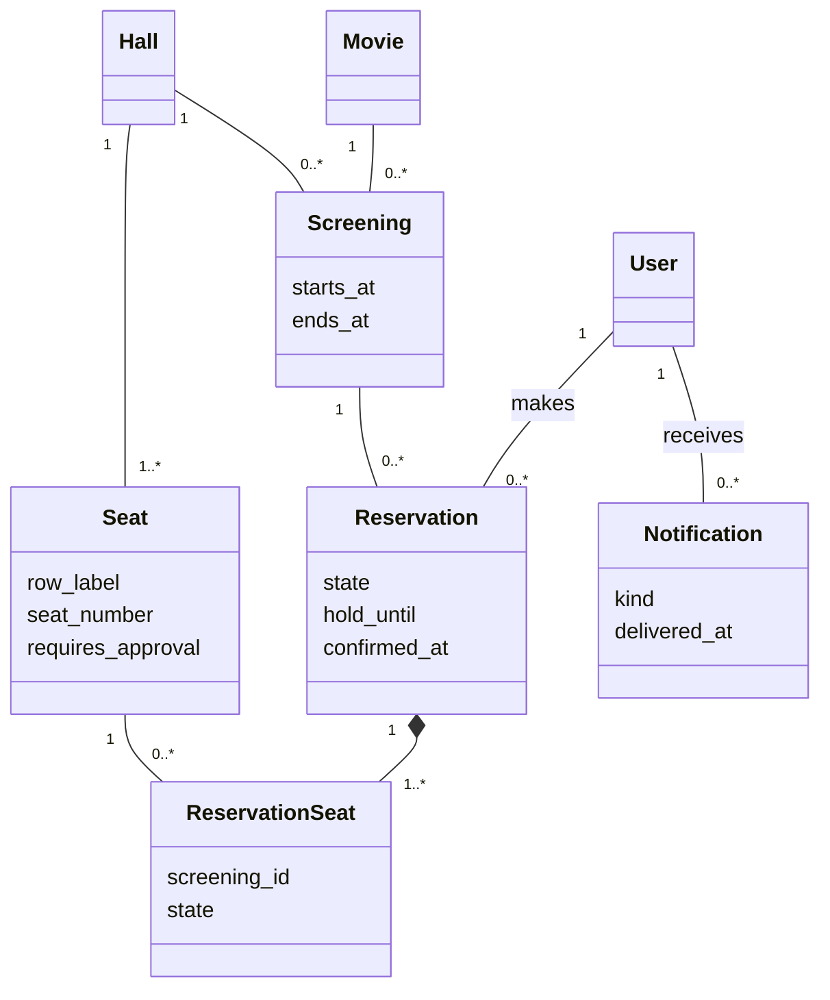
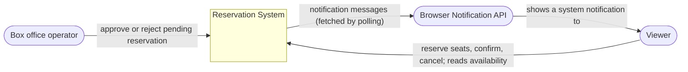
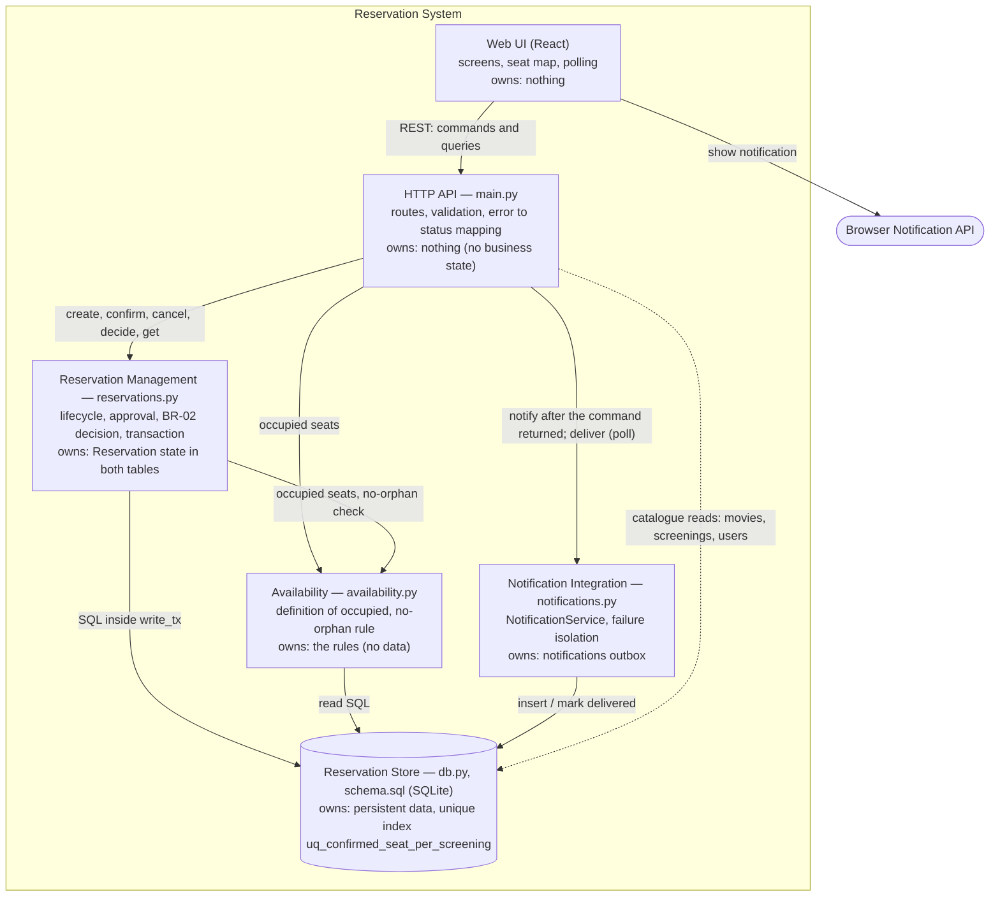
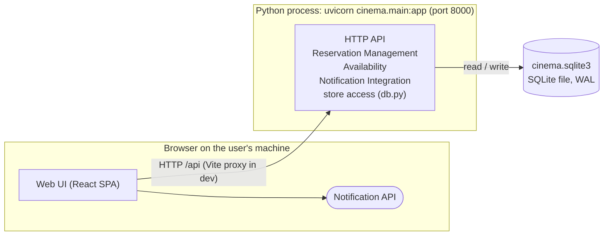
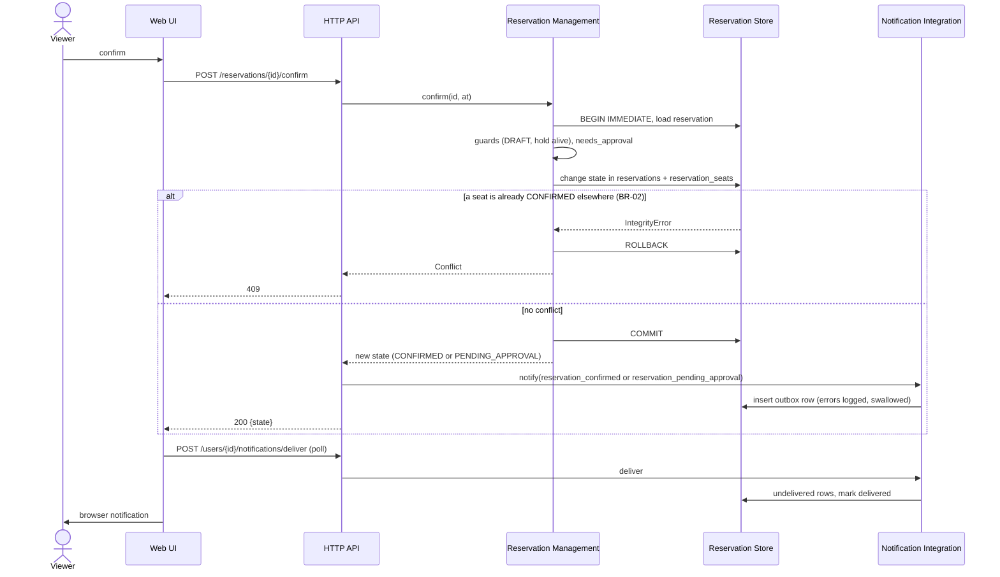
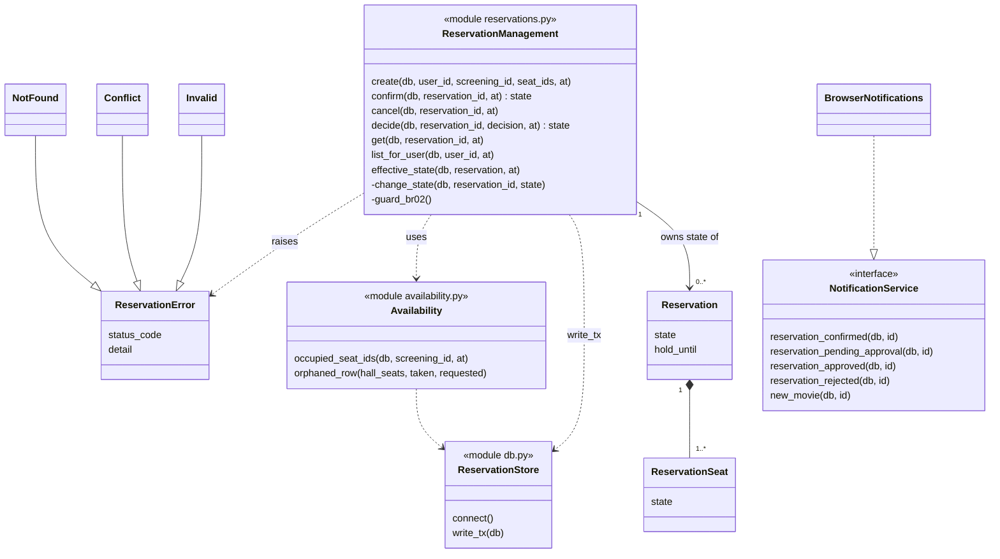

# C03 — Architecture of Confirm Reservation

Baseline: **v0.2**. Scenario: **OP-03 Confirm Reservation** with the approval variant (OP-05 completes
it). AS-IS evidence: [Part A](architecture-and-decisions.md) (updated after the notification commit
`fed5106`). Decision record: **ADR-008** in [`architecture-and-decisions.md`](architecture-and-decisions.md).
Evidence summary: last section of [`evidence-and-evolution.md`](evidence-and-evolution.md).

---

## B. Architectural drivers

| # | Source / evidence | Why it shapes the architecture | Question the architecture must answer |
|---|---|---|---|
| **D1** | BR-02; OP-03 step 4; C01 spike; Part A3 (`confirm` runs `UPDATE`, SQLite raises at the statement) | Two concurrent requests can both look conflict-free. The loser is only detected by `uq_confirmed_seat_per_screening` while the `UPDATE` runs, and a failed statement does **not** abort the transaction (Part A3: `COMMIT: reached`). | Where is the authoritative confirmation decision made, and who turns "constraint fired" into "nothing of this reservation is confirmed, answer 409"? |
| **D2** | ADR-005; Part A5, A8; `main.py` before C03 (`set_state` called from confirm, cancel, decide; two places catch `IntegrityError`) | `reservations.state` and `reservation_seats.state` must change together. Nothing stops a new endpoint from writing one without the other or skipping `ROLLBACK`. | Who owns Reservation state and the transaction around it, so that every transition is checked and written in one place? |
| **D3** | OP-05; statechart (`PENDING_APPROVAL`); ADR-003 (lazy expiry); Part A5 | `PENDING_APPROVAL` outlives the original request (hours, until `starts_at`). A later request, from another actor, performs the next transition, and expiry is derived, not stored. | Who owns the pending state and the later transitions approve / reject / expire / cancel? |
| **D4** | OP-03 step 5, Project Frame boundary rule; `notifications.py` (`notify` swallows errors, called after commit) | The business change is committed before the notification is attempted. A failing notification must not change the outcome, and a crash between commit and notification loses the message. | Does notification failure change the result of Confirm, and who holds the delivery state and any retry? |

Not a driver of this slice but visible in it: **no roles** (OP-05 specifies `403`, the application does not
implement it). Treated as an open risk in section I and the delta, not solved here.

---

## C1. Domain class model (relevant part)



Invariants attached to relationships:

- `Reservation` — `ReservationSeat`: all seat rows always carry the **same state** as their reservation (ADR-005).
- `Seat` — `ReservationSeat` per `Screening`: at most one `CONFIRMED` row (BR-02, `uq_confirmed_seat_per_screening`).
- `Reservation.state` ∈ DRAFT, PENDING_APPROVAL, CONFIRMED, CANCELLED, REJECTED (stored) plus EXPIRED (derived, ADR-003).
- "Approval" is **not** a separate class: it is the state `PENDING_APPROVAL` plus a later decision on the same
  `Reservation`. The box office operator is a role without a class (no roles in the application yet).
- `Notification` belongs to the delivery mechanism, not to the reservation domain; it is shown because D4 is about it.

---

## C2. Responsibilities

| Source | Responsibility | Must decide / own | One owner? | Why | Group with (shared state/invariant) | Separate from (other reason to change / failure / technology) |
|---|---|---|---|---|---|---|
| Confirm + statechart | decide whether a transition is allowed and perform it | lifecycle transitions of Reservation | **yes** | different parts must not decide differently (D2) | the sync of both state columns (ADR-005); the transaction boundary | HTTP handling |
| BR-02 | keep "no two CONFIRMED per seat/screening" true under concurrency | the decision "this confirm loses" and its rollback | **yes** | a race must never leave a half-confirmed reservation (D1) | lifecycle transitions (same transaction) | the unique index itself — that belongs to the data store |
| OP-05 / ADR-003 | own the pending approval and its later transitions | approve / reject / cancel / derived expiry | **yes** | state survives the request (D3) | lifecycle transitions | who is allowed to ask (authorisation, not implemented) |
| Definition of Occupied, BR-04 | decide which seats are taken and whether a selection leaves an orphan | the one definition of "occupied", the no-orphan check | **yes** | create and availability must agree | — (reads state only) | writes to Reservation state |
| Project Frame boundary | request a notification and isolate its failure | swallow/log errors, never change the business result | **yes** | external failure must not be unclear (D4) | the outbox and delivery state | lifecycle transitions |
| Part A / D4 | store and hand out notifications | outbox rows, `delivered_at` | yes | one place knows what was delivered | notification kinds and texts | reservation tables |
| ADR-004 | persist data and enforce the DB invariant | the unique index, the single write lock | yes | last line of defence for BR-02 | schema | application rules |
| HTTP | translate HTTP to commands and domain errors to status codes | routes, DTO validation, error mapping | yes | protocol concerns change independently | — | all business rules |

---

## D. Decision question

> **Rozhodovací otázka:** Kdo smí měnit stav rezervace (`reservations.state` a jeho kopii v `reservation_seats`) a kde se dělá autoritativní rozhodnutí o potvrzení, aby při souběhu platilo BR-02 a obě tabulky se nikdy nerozešly?

Driven by D1, D2, D3. D4 is answered by a consequence of the decision (section F), not by the question itself.

---

## E1. Two alternatives

**A — Reservation Management owns every transition (same deployable, new module).**

```
[HTTP API]  --confirm / cancel / decide-->  [Reservation Management]  --SQL in write_tx-->  [SQLite]
                                             owns: Reservation state in both tables,           unique index =
                                             transaction boundary, BR-02 -> 409                last line of defence
```

**B — The database owns the synchronisation, handlers keep writing state.**

```
[HTTP API handlers]  --UPDATE reservations SET state-->  [SQLite]
 guards and rules stay in each handler                    composite FK (reservation_id, state)
                                                          ON UPDATE CASCADE keeps reservation_seats.state in sync,
                                                          unique index decides BR-02
```

Both were tried, not just drawn: the cascade of B was checked in a spike (below).

**Spike for B** (in-memory SQLite; two DRAFT reservations on one seat; `FOREIGN KEY (reservation_id, state)
REFERENCES reservations (id, state) ON UPDATE CASCADE`; the partial unique index on `reservation_seats`):

```
UPDATE reservations SET state='CONFIRMED' WHERE id=2   ->  UNIQUE constraint failed: rs.screening_id, rs.seat_id
after the failure: reservations (1 CONFIRMED, 2 DRAFT), reservation_seats (1 CONFIRMED, 2 DRAFT)
COMMIT still succeeds, and the data is still consistent
```

So B really does remove the half-updated state that Part A3 showed (the cascaded statement is atomic).
It does **not** decide whether a transition is *allowed*; that stays in the handlers.

## E2. Comparison against the drivers

| Driver / criterion | Alternative A — module | Alternative B — database cascade |
|---|---|---|
| D1 concurrency (BR-02) | One function turns the index violation into 409 and rolls back; today two endpoints each catch `IntegrityError`. The index stays the last line of defence. | The cascaded `UPDATE` is atomic, so no half state even without `ROLLBACK`. Every handler still has to catch `IntegrityError` and map it to 409 itself. |
| D2 sync of both tables | One `_change_state` writes both rows and refuses to run outside a transaction; a new endpoint cannot skip it by accident because it has no SQL for state. | DB guarantees the sync for any writer, including ones that do not exist yet. Requires a schema change (`UNIQUE (id, state)`, composite FK) and a data migration of the existing database file. |
| D3 pending approval | Approve, reject, cancel and the derived expiry sit next to confirm in the same module, with the same guards. | Guards (allowed source states, `starts_at`, expiry) stay copied across handlers; the DB cannot express "only from PENDING_APPROVAL". |
| Change / ownership | One owner to read when a new state or a new transition arrives (the next change card). | Ownership is split: sync in the schema, rules in handlers, so a new state touches both. |
| Operational complexity | No new runtime element: one more Python module in the same process. | No new runtime element, but SQLite-specific behaviour (FK actions, `PRAGMA foreign_keys`) moves into the correctness argument. |

## E3. One scenario through both: Confirm, VIP seat, with a concurrent confirm of another reservation

Complication: reservation R1 (VIP seat, needs approval) and reservation R2 want the same ordinary seat X; R2 confirms first.

| Step / event | Alternative A | Alternative B |
|---|---|---|
| Confirm R1 begins | `reservations.confirm` opens `write_tx` (BEGIN IMMEDIATE), loads R1, checks guards | handler opens `write_tx`, loads R1, checks guards (its own copy) |
| approval needed | `needs_approval` → `_change_state(PENDING_APPROVAL)` writes both tables | handler runs `UPDATE reservations SET state='PENDING_APPROVAL'`; DB cascades to seats |
| request ends | `COMMIT`, returns state; API then requests a notification | `COMMIT`, handler returns; handler then requests a notification |
| approval comes later (another request, another actor) | `reservations.decide` re-reads, checks `PENDING_APPROVAL` and `starts_at`, changes state through the same `_change_state` | `decide` handler re-reads, checks the same things in its own code |
| R2 confirms seat X first, R1 approves after | `decide` → `_change_state(CONFIRMED)` → index fires → one `_guard_br02` raises `Conflict` → rollback → 409 | `UPDATE` fires index, DB undoes the statement; handler must catch and map 409 (second copy of the same `except`) |
| a handler forgets the transaction | `_change_state` raises (`not in_transaction`) — fails loudly in tests | cascade still keeps both tables equal; the missing `ROLLBACK` no longer corrupts anything |

Both satisfy the behaviour. A is better on **where decisions live**; B is better on **protection against a careless writer**.

---

## F. Decision

See **ADR-008** in `architecture-and-decisions.md`. In short: **A**, with B's cascade recorded as a possible hardening step.

Consequence for D4 (taken inside the same decision): Reservation Management **does not know** the
Notification Integration. The HTTP API asks for a notification only after the command has returned, i.e.
after commit. The notification is a separate transaction, errors are logged and swallowed, the outbox row stays
`delivered_at IS NULL` until the browser fetches it.

---

## G1. Context



There is no IdP: login is by e-mail only (`POST /auth/login`), no roles. The "Notification Service" of the Project Frame
is, in the implementation, an outbox in our own database plus the browser as receiver; a real e-mail/SMS provider
would be a second external system behind the same interface.

## G2. TO-BE static architecture



| Element | Main responsibility | owns |
|---|---|---|
| Web UI | present, send commands, poll and show notifications | – |
| HTTP API | HTTP in/out, DTO validation, map domain errors to status codes, orchestrate command → notification request | – |
| Reservation Management | every Reservation transition (create, confirm, cancel, approve, reject, derived expiry), the transaction, BR-02 → 409 | Reservation state in `reservations` **and** `reservation_seats` |
| Availability | "occupied" (ADR-003, v0.2), no-orphan (BR-04) | the rule definitions |
| Notification Integration | `NotificationService` + browser implementation, never fails the caller | `notifications` table, delivery state |
| Reservation Store | schema, unique index, single writer lock, connections | data and the BR-02 backstop |

ADR-008 is visible: the only arrow from the API towards Reservation data goes to Reservation Management;
the dotted API → Store arrow is catalogue data (movies, screenings, login) which is not part of the lifecycle.
There is no arrow from Reservation Management to Notification Integration (D4).

## G3. Ownership of transitions

| Transition | Owner of the decision | May only request it |
|---|---|---|
| (create) → DRAFT | Reservation Management (`create`) | HTTP API (viewer) |
| DRAFT → CONFIRMED | Reservation Management (`confirm`) | HTTP API (viewer) |
| DRAFT → PENDING_APPROVAL | Reservation Management (`confirm`) | HTTP API (viewer) |
| PENDING_APPROVAL → CONFIRMED | Reservation Management (`decide`) | HTTP API (operator — not authorised yet) |
| PENDING_APPROVAL → REJECTED | Reservation Management (`decide`) | HTTP API (operator — not authorised yet) |
| DRAFT / PENDING_APPROVAL / CONFIRMED → CANCELLED | Reservation Management (`cancel`) | HTTP API (viewer, operator) |
| DRAFT / PENDING_APPROVAL → EXPIRED | Reservation Management (derived in `effective_state`, no write) | – |

Availability, Notification Integration and the Store can never request a transition. The Store can only **veto** one
(the unique index).

## G4. Runtime / deployment



One backend process contains five logical elements; the SPA runs in the browser (in development served by Vite on
port 5173); the database is a file. No message broker, no second service. Mapping: Web UI → browser;
HTTP API, Reservation Management, Availability, Notification Integration → the Python process (modules `main`,
`reservations`, `availability`, `notifications`); Reservation Store → `db.py` in that process and the SQLite file.

---

## H1. Design sequence — Confirm Reservation, with BR-02 conflict



## H2. Design class diagram (focused)



The code keeps rows as dictionaries (plain SQL, ADR-002), so `Reservation` and `ReservationSeat` are the
persistent entities (tables), and the modules are the "classes" with behaviour.

---

## I. Cross-view check (before code)

| Check | Result |
|---|---|
| C02 ↔ G2 | OP-03 (both variants), OP-04, OP-05 map to Reservation Management; "occupied" to Availability; notification rule to Notification Integration. No OP is left without an element. OK |
| C2 ↔ G2 | Each responsibility row has one owner element. The HTTP-mapping and the BR-02 *index* are split on purpose (API / Store). OK |
| G2 ↔ H1 | Every participant of H1 exists in G2; every arrow in H1 is an allowed arrow in G2. **Found:** H1 first drew `RM → NI` (RM notifying). G2 forbids it (D4 decision). **Fixed in H1:** the notification request comes from the API after `RM` returned. |
| H1 ↔ H2 | `confirm`, `change_state`, `guard_br02`, `write_tx`, `notify` all have an owner. **Found:** `notify` and `deliver` were missing from H2. **Fixed:** `NotificationService` / `BrowserNotifications` are in H2; `notify` is a function of the Notification Integration module (not drawn, it is a free function). |
| statechart ↔ G3/H1 | Every transition of the statechart has exactly one owner (Reservation Management). EXPIRED is derived. OK |
| G2 ↔ G4 | Five logical elements in one Python process, the SPA in the browser. The runtime has no element the static view lacks. OK |
| ADR ↔ G2/G4 | The ADR's "only Reservation Management writes Reservation state" is the single arrow set in G2 and is checked by the test in L2. OK |
| **Found:** domain model C1 ↔ code | `Notification` is in the domain model, but its only job is delivery. Kept, flagged as belonging to the delivery mechanism. |
| **Found after C03 (PR #11):** C1 / G3 ↔ code | C1, G3 and the state diagram say `EXPIRED` is derived and never written, but `reservations.confirm` wrote it when it refused an expired hold, so the "EXPIRED is derived. OK" above was not true of the code. **Fixed in the code:** confirm now only answers `409`; the row stays `DRAFT` and reads as `EXPIRED`. |

Open and not decided in C03: authorisation (who may call `decide`); retry of a lost notification (see ADR-008).

---

## J. AS-IS → TO-BE delta

| Area | AS-IS | TO-BE | Action |
|---|---|---|---|
| Reservation state writes | `set_state` plus guards inside four endpoint functions in `main.py` | only `reservations.py` writes it, through one `_change_state` that refuses to run outside a transaction | **CHANGE** |
| BR-02 → 409 | two `except sqlite3.IntegrityError` in `confirm_reservation` and `decide_reservation` | one `_guard_br02` in Reservation Management | **CHANGE** |
| HTTP vs domain | domain code raises `HTTPException` | domain raises `ReservationError`; API maps it to the status code | **CHANGE** |
| "occupied" and no-orphan | in `main.py` (`OCCUPIED_SEATS_SQL`, loop in `create_reservation`) | `availability.py` | **CHANGE** |
| Notification call | `notify`/`notifier` defined in `main.py` | defined in `notifications.py`, called by the API after the command returned | **CHANGE** |
| DB access | `connect`, `write_tx`, `reset_db` in `main.py` | `db.py` | **CHANGE** |
| Unique index = BR-02 backstop | present, tested | same | **KEEP** |
| Notification failure never fails the reservation | `notify` swallows errors, tested | same | **KEEP** |
| Catalogue reads (movies, screenings, login) with SQL in the API | in `main.py` | unchanged (not lifecycle) | **KEEP** |
| Lost notification after a crash between commit and notify | not handled | unchanged, recorded as a risk | **VERIFY** (documented, no retry) |
| Authorisation of `decide` | none, `403` of OP-05 not implemented | out of scope of this ADR | **VERIFY** (known gap) |
