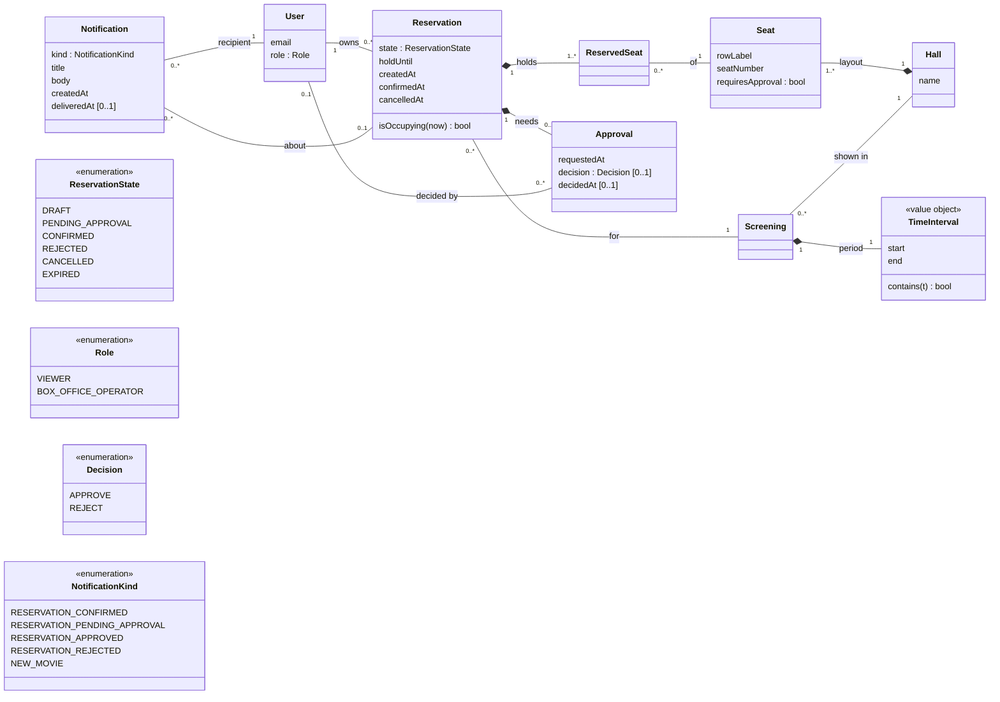
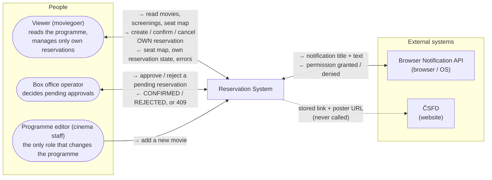
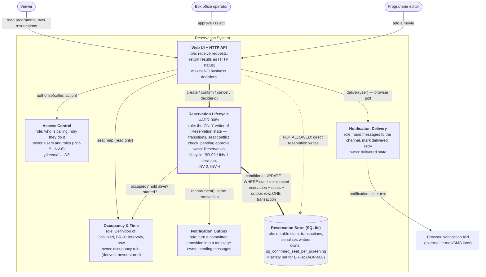

# CV4 — Architecture Drivers, Domain Model, Responsibilities and Decision Question

## Part B — Refined architecture drivers

Starting point: the drivers recorded at the end of C02
([`c02-change-impact.md`](c02-change-impact.md#dopad-změny-c02) and
[`evidence-and-evolution.md`](evidence-and-evolution.md#architectural-drivers-carried-into-c03)),
refined with the findings of the C03 Part A AS-IS trace
([`architecture-and-decisions.md`](architecture-and-decisions.md#c03--part-a-as-is-trace-of-confirm-reservation)).

"Part A Ax" refers to a section of the AS-IS trace; "M:" / "S:" are
lines of `src/cinema/main.py` / `schema.sql` at commit `a3e7a8e`, as used there.

**Code baseline for CV4:** commit `fed5106` (branch `notifications`), which adds the
`NotificationService` that Part A found missing. Part A's other findings are unchanged by it.

Only one driver is new compared with C02 (D2), and it comes directly from a Part A finding.

### Drivers

| Evidence / source | Why it affects architecture | Question architecture must answer |
|---|---|---|
| **D1 — Authoritative conflict decision for exclusive seats**<br>BR-02, OP-03, OP-05; C02 drivers 1 + 2 (evidence) / 2 (impact); C01 spike; Part A A3, A5 (unique index fires at the `UPDATE`, two endpoints each catch `IntegrityError` → 409; `DRAFT` and `PENDING_APPROVAL` are protected only by `OCCUPIED_SEATS_SQL` inside SQLite's global write lock, M:105-119) | Two concurrent requests (confirm/confirm, approve/confirm, create/create) may both observe "no conflict" if the check and the write are separate. Today the only thing that makes BR-02 true is a database constraint for `CONFIRMED` plus one database-wide lock for the other live states — a property of the current stack, not of the design | Where must the authoritative confirmation decision happen so that BR-02 remains true — for `CONFIRMED` **and** for the other occupying states (`DRAFT`, `PENDING_APPROVAL`) — and what must replace the global write lock if writers ever become concurrent? |
| **D2 — One atomic owner of state transitions** *(new, from Part A)*<br>ADR-005 (state stored twice: `reservations.state` + `reservation_seats.state`); Part A A3 runtime trace (`UPDATE reservation_seats` raised, `COMMIT: reached`); Part A A5 (decision in each endpoint's `if/elif`, write in `set_state`, used by confirm, cancel and decision); Part A A8 | SQLite does not abort a transaction on a failed statement; only the explicit `ROLLBACK` in `write_tx` (M:49-51) keeps the two tables consistent. Every endpoint must remember to use `write_tx` + `set_state`; one that does not can leave a reservation `CONFIRMED` with seats `DRAFT`, which the unique index does not see — so D1's guarantee silently breaks | Which single component owns a Reservation's state transitions (allowed transition + both rows + rollback), so that no caller can change state outside it? |
| **D3 — Long-lived pending approval**<br>OP-03 v0.2 variant, OP-05, BR-03; C02 change card ("approval may be delayed, rejected, or expire"); C02 driver 3; ADR-003 (lazy expiry); test "pending approval occupies for hours"; approve-vs-cancel race (C02 mismatch 11) | Approval may arrive hours later, so the state must survive beyond the initiating request and be decided by a different actor in a different request. It can end four ways (approve, reject, cancel, expiry at `starts_at`), two of which can race. Expiry is only evaluated lazily on read; there is no operator work queue | Who owns the pending approval state, who performs the later transition (operator decision, viewer cancel, expiry at screening start), and how does the operator find what is waiting? |
| **D4 — Notification after commit**<br>OP-03 step 5 and its failure outcome ("confirm still returns `200`"), OP-05 step 4; C02 driver 4; Part A A2, A6 (absent at `a3e7a8e`); commit `fed5106`: `notify()` runs after `write_tx` has committed, on its **own connection and transaction**, and logs and swallows every error; `BrowserNotifications` inserts a row into `notifications`; `POST /users/{id}/notifications/deliver` marks rows delivered when it hands them to the browser; `test_failed_notification_never_fails_the_reservation` | Business state is committed before the notification is recorded, in a separate transaction. If that insert fails or the process stops in between, the reservation stays `CONFIRMED` and the message is gone — only a log line remains, and nothing retries. "Delivered" means handed to a browser, not seen by the viewer. The box office is still not told that a decision is waiting (D3), and Cancel and expiry notify nobody. A real e-mail/SMS provider behind the same interface would be slow and failing *inside* the request | Notification failure must not affect confirmation success (spec, now implemented and tested) — so must the message be recorded in the **same transaction** as the state change, and who owns delivery and retry outside the request? Who is notified at each transition, including the box office operator? |
| **D5 — Caller identity and authorisation**<br>OP-05 (`403` for non-operators, *TBD: mechanism*); C02 driver 1 (impact) / 2 (evidence); C02 open items 1, 4; Part A A6 (Confirm has no user parameter; no IdP integration) | OP-05 is the first operation whose outcome depends on *who* calls it, and Confirm/Cancel do not check ownership either. The role check must sit in front of the state transitions of D2/D3, so where it lives determines what every operation's entry point looks like | Where is the caller's identity established, and which component checks "is a box office operator" and "owns this reservation" before a transition is attempted? |


## Part C1 — Domain model (updated)

**Reused:** the *Core concepts* and *Persistent state* of the Project Frame
([`intent-and-change.md`](intent-and-change.md#core-concepts)) — `Seat`, `Reservation`, `User`,
`Screening`, `Hall`. **Updated only where the Confirm scenario (Part A) and drivers D1–D5 need it.**
`Movie` is left out: it only supplies the screening's length and none of the drivers touch it.

Scope: business concepts only. No endpoints, `write_tx`, SQLite tables, the denormalised
`reservation_seats.state` copy (ADR-005) or `NotificationService` implementations — those are
technical realisations of what is drawn here.

### What changed against the Project Frame

| Concept | Status | Change | Driver |
|---|---|---|---|
| `Seat` (Resource) | reused | unchanged; `requiresApproval` already added in v0.2 | — |
| `Screening`, `Hall` | reused | unchanged | — |
| `TimeInterval` | **made explicit** | was the attribute pair `starts_at`/`ends_at`; now a value object with `[start, end)` semantics (BR-01), used by occupancy and expiry | D1, D3 |
| `Reservation` | **updated** | `state` is the *only* state; seats no longer carry a state of their own in the domain | D2 |
| `ReservedSeat` | **made explicit** | was "the set of reserved `seat_id`s"; it is the link Reservation–Seat for one Screening that BR-02 is stated over | D1, D2 |
| `User` | **updated** | gains `role` (`VIEWER`, `BOX_OFFICE_OPERATOR`); the Project Frame had User = viewer only | D5 |
| `Approval` | **new** | the pending decision and its outcome; today implicit in the state `PENDING_APPROVAL` and not stored as anything of its own | D3 |
| `Notification` | **new** | a message to a user about a committed transition; the Project Frame only had the external `NotificationService` boundary. Realised since `fed5106` by the `notifications` table of the browser implementation | D4 |

### Diagram



### Multiplicities with business meaning

| Relationship | Multiplicity | Meaning |
|---|---|---|
| Reservation – ReservedSeat | 1 to 1..\* | One reservation claims one or more seats; an empty reservation does not exist (OP-01 rejects it, `422`) |
| Reservation – Screening | \* to 1 | All seats of one reservation are for the **same** screening |
| ReservedSeat – Seat | \* to 1 | The same seat appears in many reservations over time (cancelled, expired, rejected ones stay); BR-02 restricts how many may be *occupying* at once |
| Reservation – Approval | 1 to 0..1 | An Approval exists only for a reservation that was confirmed with at least one `requiresApproval` seat; at most one, because a decision is final (deciding twice → `409`) |
| Approval – User (decided by) | \* to 0..1 | Empty while pending or when it ended by cancel/expiry; otherwise exactly the operator who decided |
| Notification – Reservation | \* to 0..1 | One reservation produces several messages over its life (pending then approved/rejected, or confirmed); `NEW_MOVIE` notifications are about no reservation. *The `fed5106` table keeps only `user_id` and a rendered text, not the reservation id — the link exists in the domain, not yet in storage* |
| Notification – User (recipient) | \* to 1 | Each message is for exactly one user; a new movie produces one message per user |

### Constraints and invariants

| ID | Constraint | Source | Driver |
|---|---|---|---|
| **BR-02** | For one `Screening` and one `Seat`, at most one `ReservedSeat` whose `Reservation` is `CONFIRMED`. | BR-02, ADR-004 | D1 |
| **INV-1** | Stronger, from the Definition of Occupied: at most one `ReservedSeat` per (`Screening`, `Seat`) whose Reservation `isOccupying(now)` — `CONFIRMED`, `DRAFT` with `now < holdUntil`, or `PENDING_APPROVAL` with `now < screening.period.start`. Today only the `CONFIRMED` part is a database constraint. | Project Frame *Definition of occupied*; C02 driver 2 | D1 |
| **INV-2** | A `ReservedSeat` has no state of its own: its state is always its Reservation's state, changed in one step for the whole Reservation. | ADR-005; Part A A3, A8 | D2 |
| **INV-3** | Every `Seat` of a Reservation belongs to the `Hall` of the Reservation's `Screening`. | OP-01 (`404` other hall) | — |
| **INV-4** | `state = PENDING_APPROVAL` ⇔ an `Approval` exists with no `decision`, and the screening has not started. `APPROVE` ⇒ `CONFIRMED` (subject to BR-02); `REJECT` ⇒ `REJECTED`. Cancel or screening start end it without a decision. | OP-03 v0.2, OP-05, BR-03 | D3 |
| **INV-5** | `Approval.decidedBy.role = BOX_OFFICE_OPERATOR`, and `decidedAt < screening.period.start`. | OP-05 (`403`, `409` after start) | D3, D5 |
| **INV-6** | Confirm and Cancel are performed by the Reservation's owner or a box office operator. *Specified as intent, not enforced today* (Part A A6: Confirm has no caller). | OP-04, C02 open item 1 | D5 |
| **INV-7** | A `Notification` refers only to a transition that has been committed; its existence or delivery never changes the Reservation's state. *Implemented in `fed5106` (`notify()` after commit, errors swallowed) and tested by `test_failed_notification_never_fails_the_reservation`.* | OP-03 failure outcome, OP-05 | D4 |
| **INV-8** | Each `Notification` is delivered to its recipient at most once (`deliveredAt` set when handed over). | `fed5106`, `test_confirm_notifies_the_viewer_once` | D4 |
| **BR-01** | `TimeInterval` is half-open `[start, end)`; a hold ends exactly at `holdUntil`, a screening has started at `start`. | BR-01 | D1, D3 |
| **BR-04** | No orphan seat: creating a Reservation must not leave exactly one free seat between occupied seats (row ends count as occupied). Evaluated at Create only. | BR-04, ADR-006 | — |

## Part C2 — System responsibilities

Same slice as Part A: **OP-03 Confirm Reservation** with its v0.2 variant (a seat requires
approval) and the later transition that completes it, **OP-05 Approve**. Rules: BR-01, BR-02,
BR-03, INV-1 … INV-8 from Part 2. Drivers: D1–D5 from Part 1.

These are responsibilities, not components: nothing here says *which* part of the code owns
them. Today they are all inside `main.py`, and several of them are repeated per endpoint
(Part A A5).

### Responsibilities

| Source | Responsibility | What it must decide / own | Needs one clear owner? | Reason |
|---|---|---|---|---|
| OP-03, OP-04, OP-05 + lifecycle statechart | **R1** — decide whether a lifecycle transition is allowed and what the target state is | the transition rules: `DRAFT` → `CONFIRMED` or `PENDING_APPROVAL` (by `requiresApproval`), `PENDING_APPROVAL` → `CONFIRMED` / `REJECTED`, which states are cancellable, which are terminal | yes | Confirm, Cancel and Decision each have their own `if/elif` today (Part A A5); different parts must not decide differently about the same Reservation |
| BR-02, INV-1, D1 | **R2** — evaluate seat conflict and preserve the exclusivity invariant | the confirmation decision under conflict: "this seat is already `CONFIRMED` / occupied for this screening" → nothing of this reservation is confirmed | yes | two concurrent requests may both observe "no conflict"; today the decision is split between the unique index (`CONFIRMED`) and the global write lock (`DRAFT`, `PENDING_APPROVAL`) |
| ADR-005, INV-2, D2 | **R3** — apply a state change atomically to the Reservation and all its seats | the transaction boundary: both rows change or neither does, including rollback on a failed statement | yes | SQLite commits after a failed statement (Part A A3); any writer that bypasses the rollback leaves a `CONFIRMED` reservation with `DRAFT` seats, invisible to the index |
| BR-01, ADR-003, OP-02, D3 | **R4** — determine time-based facts: hold still alive, screening started, derived `EXPIRED` | "now", the `[start, end)` comparison and the two causes of expiry (hold passed, pending at screening start) | yes | Confirm, Approve, Cancel and Check Availability must agree on the same boundary to the second; lazy expiry means every reader re-derives it |
| C02 change card, OP-05, INV-4, D3 | **R5** — manage pending approval | the approve / reject / expire state that survives the initiating request; the list of what is waiting for the operator; the four ways it can end and their races (approve vs cancel) | yes | the state outlives the request and is completed by a different actor in a different request; without one owner the later transition is decided ad hoc |
| OP-05 (`403`), INV-5, INV-6, D5 | **R6** — identify the caller and authorise the action | who the caller is; "is a box office operator"; "owns this reservation" | yes | a role check that exists in one endpoint and not another is no protection; must happen before R1 is asked |
| OP-03 step 5, OP-05 step 4, INV-7, D4 | **R7** — record that a notification is due after a committed transition | which transition produces which message for whom (viewer; box office still open) | design-dependent | if recorded in the same transaction as R3 it can never be lost and needs R3's owner; if recorded after commit (as in `fed5106`) it can be lost silently |
| Project Frame boundary, INV-8, D4 | **R8** — deliver notifications and retry | delivery to the external channel (browser poll today, e-mail/SMS later), the delivered marker, retry and giving up | design-dependent | external failure must have defined semantics and must never reach back into the reservation (INV-7); whether retry exists at all is a design choice |

### Grouping and separation

| Responsibility | Group with (shares state / invariant) | Separate from (and why) |
|---|---|---|
| **R1** transition rules | R3, R4, R5 — the same Reservation `state`; R1 decides, R3 writes, R4 supplies time facts, R5 is a subset of the transitions | HTTP request/response mapping (different reason to change: protocol); R6 (trust boundary: who may ask is not what is allowed); R8 (external technology) |
| **R2** conflict / exclusivity | R3 — the check and the write must be one indivisible step, or two writers both see "free"; R4 — "occupied" depends on time | the concrete storage mechanism behind it (SQLite index, write lock — external technology, may change with D1); HTTP status mapping |
| **R3** atomic state write | R1, R2 — every transition and its invariant check happen inside it; R7 if notifications are to be durable | R8 (a notification failure must not roll back a sale); connection/driver details of SQLite (external technology) |
| **R4** time facts | R1, R2, R5 — all their rules are stated over BR-01 intervals | the system clock (external, must be replaceable in tests); presentation/time-zone formatting of the frontend |
| **R5** pending approval | R1, R3 — approve/reject/cancel/expire are transitions of the same state; R2 — approval enters `CONFIRMED` through the same invariant | R6 (who is an operator changes with the identity mechanism, not with approval rules); the operator's query/work-queue view (read side, different reason to change); R8 |
| **R6** caller identity & authorisation | — (reads the reservation's owner, owns no reservation state) | R1–R5 (trust boundary and different reason to change: IdP / login technology); must sit in front of them, not inside each endpoint |
| **R7** record notification due | R3 if the message must survive a crash (same transaction); the event that caused it (R1) | R8 — recording "what must be said" is business; sending it is external technology with its own failures |
| **R8** delivery & retry | — (owns only its own delivery state, `deliveredAt`) | R1–R3 (failure boundary: a slow or failing provider must not affect Confirm — INV-7); R7 (different reason to change: channel and provider) |

## Part D — Main decision question


> #### Decision question:
> Today the confirmation decision for BR-02 is made inside SQL: the unique index *uq_confirmed_seat_per_screening* rejects a second CONFIRMED seat, while DRAFT and PENDING_APPROVAL seats are protected only by SQLite's global write lock and by every endpoint remembering to use write_tx + set_state. Should we change it and move the decision into one application-level owner of the Reservation's state transitions, or leave it inside the database and extend it so that the database alone guarantees exclusivity for every occupying state

### Part E1 - Alternatives structural sketch

#### AS-IS — decision split between endpoints and SQL

```
[Reservation Application (main.py)]
  ├─ [confirm endpoint]  ── decides state, catches IntegrityError → 409
  ├─ [decision endpoint] ── decides state, catches IntegrityError → 409
  ├─ [cancel endpoint]   ── decides state
  └─ [create endpoint]   ── checks "occupied" itself
          |  each one: write_tx + set_state (by convention)
          v
[SQLite]
  ├─ unique index        ── BR-02 for CONFIRMED only
  └─ global write lock   ── only thing protecting DRAFT / PENDING_APPROVAL
```

#### Alternative A — move the decision into the application
```
[Reservation Application]
  ├─ [endpoints]                     ── receive request, map outcome to HTTP, no decisions
  |       |
  |       v
  └─ [Reservation Lifecycle]  (NEW)  ── the ONLY writer of Reservation state
        ├─ transition rules (R1)
        ├─ occupancy / conflict check for all states (R2)
        └─ one transaction: reservation + seats (R3)
          |
          v
[SQLite]
  └─ unique index        ── kept only as a backstop or dropped
```


#### Alternative B — keep it in SQL and extend it
```
[Reservation Application]
  └─ [endpoints]         ── unchanged; still decide transitions, map errors to 409
          |
          v
[SQLite]                 ── the authority for exclusivity
  ├─ unique index on CONFIRMED                      (as today)
  ├─ [seat_holds]  (NEW) ── one row per occupying seat,
  |                         UNIQUE (screening, seat) for DRAFT / PENDING_APPROVAL / CONFIRMED
  └─ [triggers]    (NEW) ── keep reservations and reservation_seats in sync,
                            remove holds on cancel / reject / expiry
```

| | What moves | What is new | What disappears |
|---|---|---|---|
| **Alternative A** | transition rules and conflict handling move from each endpoint into one component | `Reservation Lifecycle` component | duplicated `if/elif` and `IntegrityError` → 409 mapping in endpoints |
| **Alternative B** | nothing moves in the application | `seat_holds` table + its unique constraint, sync triggers | reliance on the global write lock and on endpoints remembering `write_tx` |

### Part E2 - Alternatives against the drivers

Four drivers from Part B that the two alternatives answer differently. D5 (caller identity) is
left out: both alternatives put the authorisation check in front of the transition in the same
way, so it does not tell them apart.

| Driver | Alternative A — decision in one application owner | Alternative B — decision stays in SQL, extended |
|---|---|---|
| **D1 — Authoritative conflict decision for exclusive seats** | The `Reservation Lifecycle` checks occupancy for `CONFIRMED`, live `DRAFT` and `PENDING_APPROVAL` in one query (today's `OCCUPIED_SEATS_SQL`) and then writes. This is correct only while check and write run under a lock that excludes other writers: today `BEGIN IMMEDIATE`. With concurrent writers (e.g. PostgreSQL) it would need `SELECT … FOR UPDATE` on the seat rows or a per-screening lock row; otherwise two requests both see "free" again. If the unique index is dropped, a bug in the component becomes a silent double booking; if it is kept, `CONFIRMED` still has a database backstop and the other states do not. | A `seat_holds` row with `UNIQUE (screening_id, seat_id)` is inserted for every occupying seat, so the database rejects a second `DRAFT`, `PENDING_APPROVAL` or `CONFIRMED` hold even without the global write lock and on any code path. The conflict appears as an `IntegrityError` at the `INSERT`, which Create must now also catch and map to `409` (today only Confirm and Decision do). Create's own occupancy query becomes an early, friendlier check instead of the guarantee. |
| **D2 — One atomic owner of state transitions** | All transitions go through one function that checks the allowed transition, updates `reservations` and `reservation_seats` and owns the `ROLLBACK`. The duplicated `if/elif` chains in Confirm, Cancel and Decision and the two `IntegrityError` → `409` mappings disappear. Python cannot forbid another module from running its own `UPDATE`, so "only writer" is still enforced by structure and review, but there is one place to review and test instead of four. | An `AFTER UPDATE OF state ON reservations` trigger writes `reservation_seats.state` and adds/removes `seat_holds`. The reservation update and its seat updates become **one statement**, so the Part A A3 failure (first `UPDATE` kept, second failed, `COMMIT` reached) can no longer leave the two tables out of sync, even if an endpoint forgets `write_tx`. The *allowed-transition* rules stay duplicated in the endpoints, so the database guarantees consistency but not that the transition was legal (e.g. `REJECTED` → `CONFIRMED`) unless a `BEFORE UPDATE` trigger with `RAISE(ABORT)` also encodes the state machine in SQL. |
| **D3 — Long-lived pending approval** | Approve, reject, cancel and the derived expiry at `starts_at` are methods of the same component, so the approve-vs-cancel race is decided in one place under one transaction (today: two endpoints that each re-read the state). Lazy expiry (ADR-003) stays as it is, because the component re-evaluates `now < hold_until` / `now < starts_at` on every read. An operator work queue is a new query next to it, not a new mechanism. | A unique index cannot contain time: SQLite accepts `WHERE … > datetime('now')` in a partial index but then rejects every write with "non-deterministic use of datetime() in an index" (checked on SQLite 3.53), and an index is never re-evaluated as time passes anyway. So a `seat_holds` row does not disappear when a `DRAFT` hold or a pending approval runs out. A seat with an expired hold stays blocked for the next Create until something deletes the row: Create must first `DELETE` expired holds for the requested seats in the same transaction, or a cleanup job must run — which brings the hold-expiry rule back into application code and ends ADR-003's "no background job". Approve has to switch the hold from pending to confirmed and Reject/Cancel delete it, all in triggers. |
| **D4 — Notification after commit** | The component knows which transition just happened, so it can insert the `notifications` row **in the same transaction** as the state change (an outbox). A crash after commit no longer loses the message, and `deliver` (or a later e-mail dispatcher with retry) reads the outbox. Message texts, seat lists and Prague time formatting stay in Python. | The endpoints keep calling `notify()` after commit, so the D4 gap (message lost if the insert fails or the process stops in between) stays. To close it in SQL, an `AFTER UPDATE` trigger would have to insert the `notifications` row, which makes it atomic, but then the Czech message text, the seat list and the time-zone formatting either move into SQL or the row stores only the event and the text is rendered later at delivery. |


### Part E3 - Running scenario: delayed approval with a concurrent cancel

**Scenario** (C02, same as Part A): OP-03 Confirm Reservation with the v0.2 variant, completed
later by OP-05 Approve. A viewer reserves seats **J5, J6** in the VIP row J
(`requires_approval = 1`) for a screening that starts in three hours.

**Complication — concurrency:** hours later the box office operator approves at the same moment
as the viewer cancels. This is the race measured in C02 (mismatch 11,
`test_approve_and_cancel_arriving_together_always_end_cancelled`). Required outcome: Cancel
answers `200` in either order, Approve answers `200` or `409`, the reservation always ends
`CANCELLED` with its seats free, and it never ends `CONFIRMED` after a `200` Cancel.

Each stop says first what C02 requires (*must*), then how each alternative realises it.

| Stop / event | Alternative A — decision in one application owner | Alternative B — decision stays in SQL, extended |
|---|---|---|
| **1. Viewer creates the reservation**<br>*must:* `DRAFT`, 15-minute hold, J5 and J6 read occupied | Endpoint calls `lifecycle.create(...)`. Under `BEGIN IMMEDIATE` it runs the occupancy query, inserts the reservation and its seat rows. Exclusivity of the `DRAFT` comes from the lock + query, as today. | Endpoint inserts the reservation and seat rows as today; the insert also creates two `seat_holds` rows. Exclusivity of the `DRAFT` now comes from `UNIQUE (screening_id, seat_id)` on `seat_holds`. |
| **2. Confirm Reservation starts**<br>*must:* one transaction; stored state is `DRAFT` and the hold is still running | Endpoint calls `lifecycle.confirm(id)`; the transaction, the `DRAFT` check and the hold check (`now < hold_until`) are inside the component. The endpoint only maps the result to HTTP. | `confirm_reservation` opens `write_tx` and checks `DRAFT` and the hold itself, as today. |
| **3. Approval is required**<br>*must:* `PENDING_APPROVAL`, no `confirmed_at`, seats stay blocked; viewer told "waiting" | The component sees a seat with `requiresApproval`, writes `PENDING_APPROVAL` to `reservations` and `reservation_seats`, and inserts the "waiting" notification row **in the same transaction**. | The endpoint decides `PENDING_APPROVAL` and runs one `UPDATE reservations`; the trigger updates `reservation_seats` and keeps the two `seat_holds` rows. After commit, `notify()` records the "waiting" message in its own transaction (lost if the process stops in between, D4). |
| **4. Approval arrives later — 15 minutes pass, then hours**<br>*must:* the pending reservation is not on the hold clock; J5, J6 stay occupied | Occupancy is derived on every read: `PENDING_APPROVAL` occupies while `now < starts_at`, regardless of `hold_until`. Nothing has to run when the 15 minutes pass. | The `seat_holds` rows simply stay, so the seats stay blocked — correct here. (The same "rows stay" behaviour is what makes an expired *`DRAFT`* keep blocking a seat; see E2, D3.) |
| **5. Another viewer tries to create on J5**<br>*must:* `409`, the pending reservation is untouched | The occupancy query in `lifecycle.create` finds the `PENDING_APPROVAL` row → `409`. Correct because the query and the insert run under the same write lock. | The `INSERT` into `seat_holds` violates the unique constraint → `IntegrityError` → Create must map it to `409` (a new mapping; today Create never sees `IntegrityError`). Correct on any code path, without relying on the lock. |
| **6a. Complication — Approve commits first, Cancel right after**<br>*must:* Approve `200 CONFIRMED`, then Cancel `200 CANCELLED` (BR-03 allows cancelling `CONFIRMED`) | `lifecycle.approve` and `lifecycle.cancel` run one after the other under the write lock; each re-reads the state in its own transaction. Result `CANCELLED`, matching the test. | Same order of events through the endpoints and triggers: the approve `UPDATE` moves the holds to confirmed, the cancel `UPDATE` makes the trigger delete them. Result `CANCELLED`. |
| **6b. Complication — Cancel commits first, Approve right after**<br>*must:* Cancel `200`, Approve `409`; never `CONFIRMED` | `lifecycle.approve` re-reads, sees `CANCELLED`, refuses → `409`. The "is this transition allowed" rule and the write are in one function, so on a database without a global lock it is written once as a conditional update (`… WHERE id = ? AND state = 'PENDING_APPROVAL'`, 0 rows → `409`) or `SELECT … FOR UPDATE`. | On today's SQLite the `decision` endpoint re-reads under `BEGIN IMMEDIATE`, sees `CANCELLED` → `409`. The unique constraint does **not** help here: both requests act on the *same* reservation. Without the global lock, both could read `PENDING_APPROVAL` and the later `UPDATE` would win — `CONFIRMED` after a `200` Cancel — unless every endpoint uses a conditional update or a `BEFORE UPDATE` trigger rejects `CANCELLED → CONFIRMED` with `RAISE(ABORT)`, i.e. the state machine is also written in SQL. |
| **7. Viewer is notified of the outcome**<br>*must:* a failed notification never fails Approve or Cancel (INV-7) | In 6a the "approved" row is written in Approve's transaction, so it is never lost; the viewer then cancels and, as today, gets no cancel message. Adding a "cancelled" message is one line in `lifecycle.cancel`, because every transition passes through it. | In 6a `notify("reservation_approved")` runs after Approve's commit, as today: the viewer may see "Rezervace schválena" for a reservation they cancel a second later, and the message is lost if the process stops in between. A "cancelled" message has to be added to the cancel endpoint, or to a trigger. |
| **8. Seats are free again**<br>*must:* J5, J6 read free; another viewer can now create on them | Nothing to clean up: `CANCELLED` does not occupy, so the next occupancy query sees the seats free. | The trigger on `→ CANCELLED` deletes both `seat_holds` rows. If that transition is missing from the trigger, the seats stay blocked for every future Create although the reservation is `CANCELLED`. |

#### Verification — do both alternatives realise the required behaviour?

| Required behaviour (C02) | Alternative A | Alternative B |
|---|---|---|
| Pending seats stay occupied for hours (stops 3–5) | yes — derived from state and `starts_at` | yes — the hold rows stay until a transition removes them |
| Another viewer is refused (stop 5) | yes, **while** check and insert run under one write lock | yes, on any code path, by the unique constraint |
| Race ends `CANCELLED`, never `CONFIRMED` after a `200` Cancel (stops 6a/6b) | yes — one guarded transition function | yes on today's SQLite (global lock); with concurrent writers only with conditional updates or a state-machine trigger in every path |
| Notification failure never fails the operation (stop 7) | yes, and the message is durable (outbox in the same transaction) | yes, but the message can still be lost after commit, as today |
| Seats free after cancel (stop 8) | yes — nothing stored to clean up | yes, if the trigger covers every transition that ends occupancy (cancel, reject, expiry) |

**Different consequences exposed by the scenario.** Both alternatives can realise the C02
behaviour on today's stack. The race (6b) shows what each one depends on: Alternative A needs
its single transition function to be guarded against concurrent writers — one place to get
right. Alternative B protects seat exclusivity between *different* reservations (stop 5) on any
path, but not the state of *one* reservation under concurrent requests (stop 6b); that still
needs the state-machine rule, which then has to exist in SQL or in every endpoint. Stops 4 and
8 show B's other cost: occupancy is stored, so every way out of an occupying state must delete
it, while A derives occupancy and has nothing to clean up.

### Part E4 - Decision

**Alternative A** is chosen — the confirmation decision moves into one application-level
owner of the Reservation's state transitions, the unique index stays as a safety net, and
transitions are written as conditional updates. Recorded with its reasons, accepted negative
consequences and reconsider conditions as
[ADR-008](architecture-and-decisions.md#adr-008--where-is-the-confirmation-decision-enforced-so-that-br-02-stays-true-under-concurrency).

## Part G1 — Context diagram (current system)

Note: `Reservation System` = the React
web app **and** the FastAPI backend with its SQLite file; nothing inside it is drawn.



Arrows: `→` is what goes **into** the system from the left, or **out of** it to the right;
`←` is the answer. Dashed = data that points outside, but nothing is called.

| Connection | What crosses the boundary | Today's mechanism |
|---|---|---|
| Viewer → System | **read only** for the programme: movies, screenings, seat availability. **Writes only their own reservation:** create, confirm, cancel. Login by e-mail. Cannot add or change movies or screenings | web app → HTTP API |
| System → Viewer | seat map with an `occupied` flag per seat, reservation id and state, `hold_until`, failure reasons | HTTP responses shown in the web app |
| Box office operator → System | decision `approve` / `reject` for one reservation (OP-05) | `POST /reservations/{id}/decision` directly — **no operator screen, no role check** (D5) |
| Programme editor → System | a new movie — the **only** role that changes the programme | `POST /movies` directly — no screen; outside the Project Frame's scope, but the endpoint exists and triggers a `NEW_MOVIE` notification to every user |
| System → Browser Notification API | title and body of each undelivered notification, once | the web app polls `POST /users/{id}/notifications/deliver` every 15 s and calls `new Notification(...)` |
| Browser Notification API → System | whether the viewer allowed notifications | `Notification.requestPermission()` when the bell is clicked |
| System ⇢ ČSFD | nothing is called; the movie record stores a ČSFD link and a poster URL that the viewer's browser opens / loads | static data from `seed.sql` |

**Deliberately not in the diagram, because it does not exist today:**
- **Identity provider.** Login is "an e-mail identifies the user, created on first login" —
  no password, no IdP, no roles (`/auth/login`). This is driver D5.
- **E-mail / SMS provider.** The Project Frame names a third-party provider behind
  `NotificationService`; the only implementation is the browser one. A provider would be a
  new external system on this boundary, replacing or joining the Browser Notification API.
- **SQLite** is a file inside the system (ADR-002), not an external system.

## Part G2 — Logical structure 

Responsibilities R1–R8 from Part C2 grouped into six logical elements inside
`Reservation System`. This is the **target** structure that ADR-008 decides. Elements are logical, not classes or
deployables.



### Responsibility → primary owner

| Responsibility (Part C2) | Primary owner | Note |
|---|---|---|
| **R1** — decide whether a transition is allowed, target state | Reservation Lifecycle | one place instead of the `if/elif` in each endpoint |
| **R2** — evaluate seat conflict, preserve BR-02 / INV-1 | Reservation Lifecycle | asks `Occupancy & Time` for the facts; the index in the store is only the backstop |
| **R3** — apply a state change atomically to reservation + seats | Reservation Lifecycle | uses the store's transaction; endpoints no longer call `write_tx` / `set_state` |
| **R4** — time-based facts: hold alive, screening started, derived `EXPIRED` | Occupancy & Time | also serves the read-only seat map (OP-02) |
| **R5** — manage pending approval | Reservation Lifecycle | grouped with R1/R3 (Part C2): approve, reject, cancel and expiry are transitions of the same state |
| **R6** — identify the caller, authorise | Access Control | **planned** — today there are no roles (D5) |
| **R7** — record that a notification is due | Notification Outbox | called by the lifecycle **inside** its transaction |
| **R8** — deliver notifications, retry | Notification Delivery | the only element that talks to the external channel |

### Allowed dependencies

| From → To | Interaction | Why it is allowed |
|---|---|---|
| Web UI + HTTP API → Access Control | `authorise(caller, action)` | every operation is checked before a transition is attempted (R6 in front of R1) |
| Web UI + HTTP API → Reservation Lifecycle | `create / confirm / cancel / decide(id)` → new state or a refusal reason | the only way to change a reservation |
| Web UI + HTTP API → Occupancy & Time | seat map (read only) | OP-02 changes nothing, so it does not need the lifecycle |
| Web UI + HTTP API → Notification Delivery | `deliver(user)` (the browser's poll) | delivery is outside every business transaction |
| Reservation Lifecycle → Occupancy & Time | is the seat occupied, is the hold alive, has the screening started | one Definition of Occupied for writes and reads |
| Reservation Lifecycle → Notification Outbox | `record(event)` in the same transaction | the message cannot be lost after commit (D4) |
| Reservation Lifecycle → Reservation Store | conditional `UPDATE`, one transaction | ADR-008 |
| Notification Delivery → Browser Notification API | notification title + text | the only external call; its failure never reaches the lifecycle (INV-7) |

